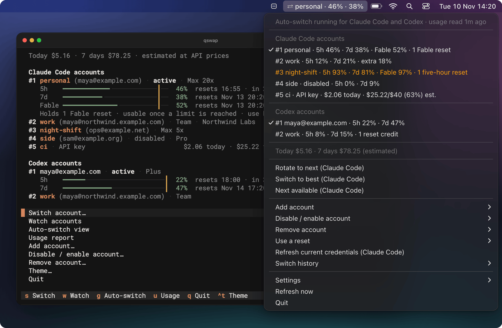
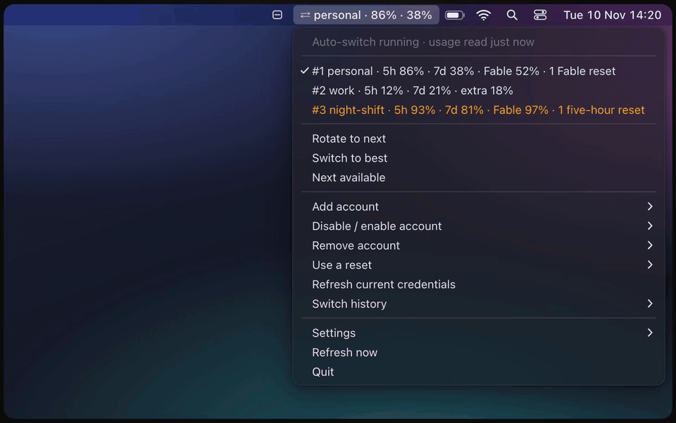
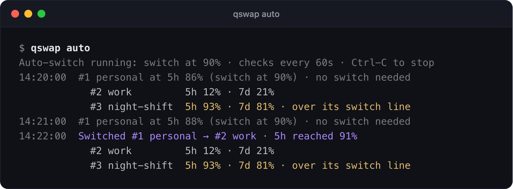
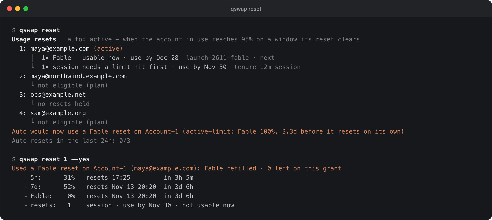
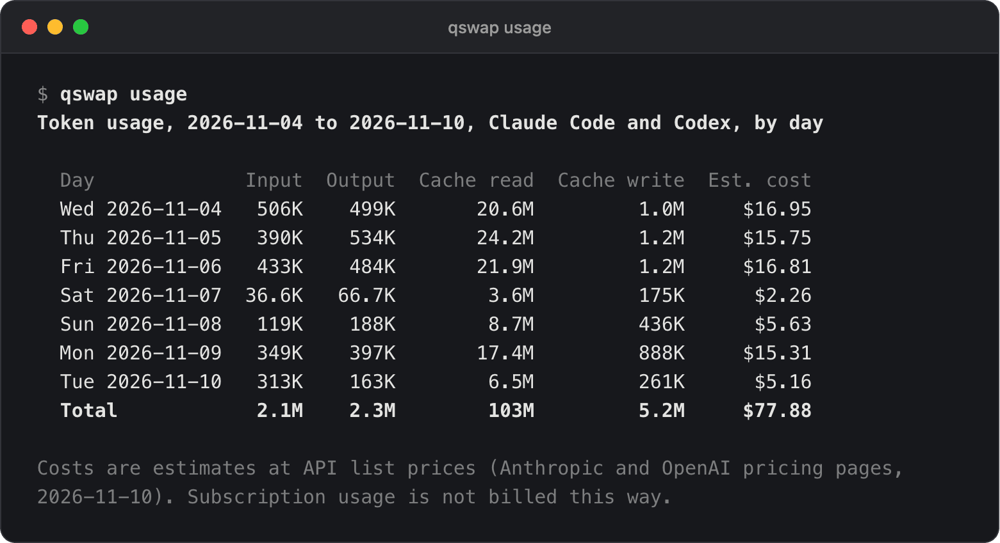
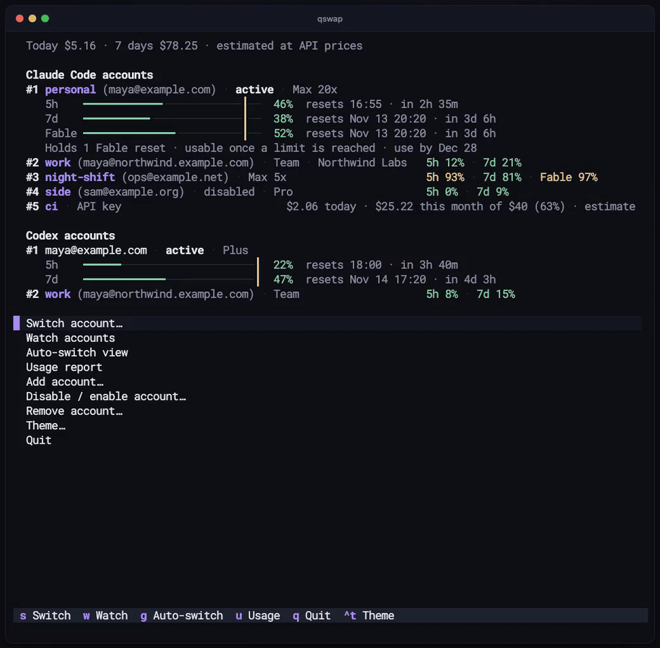
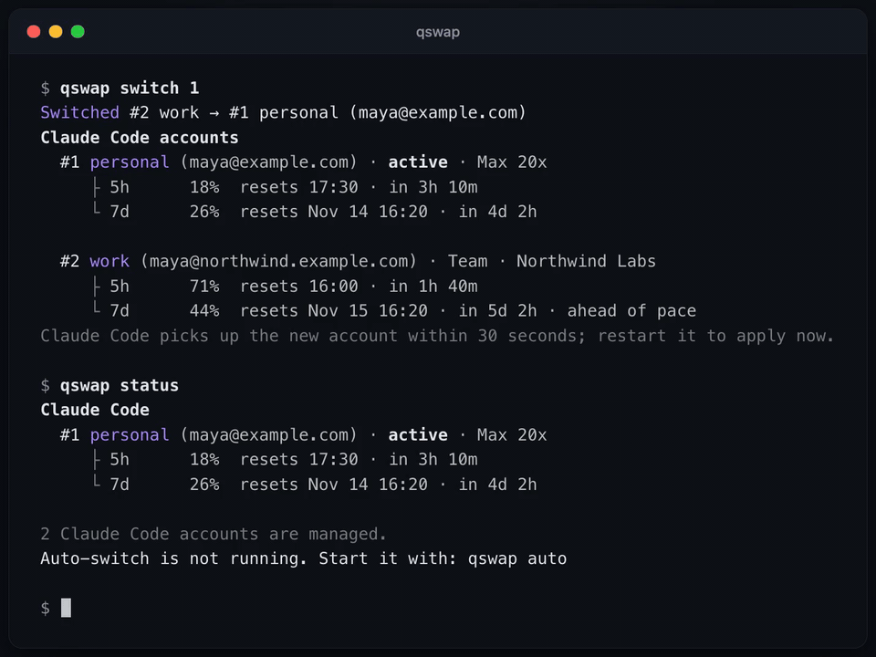

# ai-quota-swap (qswap): Claude Code and Codex account switcher

ai-quota-swap (the `qswap` command) is an account switcher for Claude Code and the OpenAI Codex CLI. It keeps multiple Claude accounts (Pro, Max, Team) and Codex accounts on one machine, and shows each one's 5-hour and weekly usage limits in the macOS menu bar or a terminal. Switch with one command, or let qswap switch for you as the active account nears its rate limit. Running Claude Code sessions move to the new account without logging out or restarting.

<picture>
  <source media="(prefers-color-scheme: light)" srcset="https://raw.githubusercontent.com/seangeng/ai-quota-swap/main/assets/screenshots/raw/hero-light.png">
  
</picture>

Every screenshot and recording on this page shows made-up accounts and comes from the [demo harness](https://github.com/seangeng/ai-quota-swap/blob/main/scripts/demo/README.md). The terminal pictures are qswap's own output. The menu bar pictures are drawings of the menu rows, cost chart and notification text the app produces.

## What you get

### The macOS menu bar app

`qswap menubar` puts the active account in the menu bar with how much of its 5-hour and weekly windows it has used, as `⇄ personal · 46% · 38%`. Its menu lists every Claude Code and Codex account with usage and held resets, and charts the last seven days of estimated cost by account. Click an account to switch to it, or run `qswap menubar --auto-switch` and let it switch for you; a notification says when and why.



Every row of the menu, its settings and how to start it at login: [docs/menubar.md](https://github.com/seangeng/ai-quota-swap/blob/main/docs/menubar.md).

### Auto-switch before the usage limit

`qswap auto` checks the active account every minute. When a window reaches 90%, it moves to the account with the most room left, and running Claude Code sessions carry on with the new account. `qswap auto --dry-run` says what it would do and changes nothing. The menu bar's auto-switch runs the same engine with the same settings, so on a Mac you do not need `qswap auto` as well.

<picture>
  <source media="(prefers-color-scheme: light)" srcset="https://raw.githubusercontent.com/seangeng/ai-quota-swap/main/assets/screenshots/raw/auto-light.png">
  
</picture>

Strategies, switch lines, cron and running it as a service: [docs/auto-switch.md](https://github.com/seangeng/ai-quota-swap/blob/main/docs/auto-switch.md).

### Usage resets

Some plans come with banked usage resets (Claude Code's `/limit-reset`), and each kind clears different windows: a Fable reset clears Fable's weekly window only, a weekly reset the all-models weekly window. `qswap reset` lists what every account holds, and `qswap reset 1` spends one on account 1; a spent reset cannot be undone. By default, auto-switch spends the narrowest reset that helps only once no other account can take over, at most 3 in 24 hours for each provider. The picture has `resets.auto` set to `active`, which spends the active account's own reset as soon as a window it clears reaches 95%.

<picture>
  <source media="(prefers-color-scheme: light)" srcset="https://raw.githubusercontent.com/seangeng/ai-quota-swap/main/assets/screenshots/raw/reset-light.png">
  
</picture>

The kinds, when auto mode spends each, and the guards: [docs/resets.md](https://github.com/seangeng/ai-quota-swap/blob/main/docs/resets.md).

### Token usage and cost

`qswap usage` prices the tokens in this machine's Claude Code and Codex session files at API list prices, by day, account, model or project. On a subscription you pay a flat price, so the figure is what the same usage would cost through the API.

<picture>
  <source media="(prefers-color-scheme: light)" srcset="https://raw.githubusercontent.com/seangeng/ai-quota-swap/main/assets/screenshots/raw/usage-light.png">
  
</picture>

A Console API key can be an account too: `qswap add-token` adds it, and `qswap budget 5 40` gives it a monthly budget of $40 (`qswap credit` records a prepaid credit). qswap's auto-switch enforces the budget, so it applies only while auto-switch runs; for a hard cap, set a spend limit on the key's workspace in the Claude Console. With `autoswitch.includeApiKeyAccounts` on, auto-switch moves to a key only when no subscription can take over.

Reports and prices: [docs/usage.md](https://github.com/seangeng/ai-quota-swap/blob/main/docs/usage.md). Keys, budgets and credits: [docs/api-accounts.md](https://github.com/seangeng/ai-quota-swap/blob/main/docs/api-accounts.md).

### The terminal dashboard (TUI) and the CLI

Bare `qswap` in a terminal opens a dashboard of every account, on macOS, Linux and Windows: `s` switches, `w` watches every account, `g` opens auto-switch and `u` shows tokens and cost. Each view is also a command (`qswap list`, `qswap status`, `qswap usage`), with `--json` for scripts.



Every screen and key: [docs/dashboard.md](https://github.com/seangeng/ai-quota-swap/blob/main/docs/dashboard.md).

## Install

qswap is on PyPI as `ai-quota-swap`. Install it with [uv](https://docs.astral.sh/uv/); on a Mac, with the menu bar:

```bash
uv tool install 'ai-quota-swap[menubar]'
qswap menubar                 # start the menu bar now and at every login
qswap menubar --auto-switch   # let it switch Claude Code accounts for you
```

On macOS 26 and later, the menu bar icon has been seen not to appear when qswap runs on Homebrew's or python.org's Python, and `qswap menubar` warns when that is the case. To avoid it, put qswap on uv's own Python: `uv tool install --managed-python --force 'ai-quota-swap[menubar]'`.

On Linux (WSL included) or Windows:

```bash
uv tool install ai-quota-swap
```

pipx takes the same package names (`pipx install 'ai-quota-swap[menubar]'`, `pipx install ai-quota-swap`). You need Python 3.12 or newer, and Claude Code logged in; Codex is optional. `qswap upgrade` updates qswap with whichever tool installed it (on Windows it prints the command to run).

## Quick start

Log in to Claude Code with your first account, then save that login:

```text
$ qswap add --alias personal
Added #1 personal (maya@example.com)
To add another account, log in to it in Claude Code (/login), then: qswap add
```

In Claude Code, run `/login` with your next account. Go straight to `/login`: a `/logout` first may revoke the saved login of the account you leave. Then save the second account, look at both, switch back to the first and check where you are:



```text
$ qswap add --alias work
Added #2 work (maya@northwind.example.com)
$ qswap list
Claude Code accounts
  #1 personal (maya@example.com) · Max 20x
     ├ 5h      18%  resets 17:30 · in 3h 10m
     └ 7d      26%  resets Nov 14 16:20 · in 4d 2h

  #2 work (maya@northwind.example.com) · active · Team · Northwind Labs
     ├ 5h      71%  resets 16:00 · in 1h 40m
     └ 7d      44%  resets Nov 15 16:20 · in 5d 2h · ahead of pace
$ qswap switch 1
Switched #2 work → #1 personal (maya@example.com)
...
Claude Code picks up the new account within 30 seconds; restart it to apply now.
$ qswap status
Claude Code
  #1 personal (maya@example.com) · active · Max 20x
     ├ 5h      18%  resets 17:30 · in 3h 10m
     └ 7d      26%  resets Nov 14 16:20 · in 4d 2h

2 Claude Code accounts are managed.
Auto-switch is not running. Start it with: qswap auto
```

The account you just added is the one Claude Code is logged in to, so it is the active one, and `qswap switch 1` goes back to the first. Switch by number, email or alias. Running Claude Code sessions move to the new account within about 30 seconds on macOS, and from their next message on Linux and Windows.

To let qswap switch for you, run `qswap auto`. The menu bar's auto-switch is off until you turn it on with `qswap menubar --auto-switch`. The [quick start guide](https://github.com/seangeng/ai-quota-swap/blob/main/docs/quickstart.md) has each step in more detail.

## Everything else

| To | Run | Read |
|---|---|---|
| keep several Codex logins | `qswap codex add`, then `qswap codex login` (not plain `codex login`) for each further account | [codex.md](https://github.com/seangeng/ai-quota-swap/blob/main/docs/codex.md) |
| run Claude Code as another account in one terminal only | `qswap run 2` | [sessions.md](https://github.com/seangeng/ai-quota-swap/blob/main/docs/sessions.md) |
| pick the account for a directory | `qswap map 2 ~/work/client-app` | [sessions.md](https://github.com/seangeng/ai-quota-swap/blob/main/docs/sessions.md#pick-the-account-per-directory) |
| script it | `--json`, and `qswap auto --once` for cron, with exit codes | [json-output.md](https://github.com/seangeng/ai-quota-swap/blob/main/docs/json-output.md) |
| see or change a setting | `qswap config`, `qswap config set autoswitch.threshold 85` | [settings.md](https://github.com/seangeng/ai-quota-swap/blob/main/docs/settings.md) |
| find what is wrong and how to fix it | `qswap doctor` | [troubleshooting.md](https://github.com/seangeng/ai-quota-swap/blob/main/docs/troubleshooting.md) |
| move over from claude-swap | `cswap export FILE`, then `qswap import FILE`; never run both on the same accounts | [coming-from-claude-swap.md](https://github.com/seangeng/ai-quota-swap/blob/main/docs/coming-from-claude-swap.md) |
| remove everything qswap stored | `qswap purge` | [SECURITY.md](https://github.com/seangeng/ai-quota-swap/blob/main/SECURITY.md#remove-everything) |
| find any command | `qswap help`, `qswap help COMMAND` | [all the docs](https://github.com/seangeng/ai-quota-swap/blob/main/docs/README.md) |

## What is new or experimental

- The menu bar is new, and macOS only.
- Codex support is experimental. It has been tested against fakes and with one real account; switching between two real Codex accounts has not been tried yet. Read [docs/codex.md](https://github.com/seangeng/ai-quota-swap/blob/main/docs/codex.md) before your first Codex switch.
- `qswap run` is experimental, and covers Claude Code only.
- Switching to an API key is new. It moves every running Claude Code session onto the key and keeps the subscription logged in underneath:

```text
$ qswap switch 5
Switched #1 personal → #5 ci (API key)
Running Claude Code sessions move to the key within a few seconds. #1 personal
stays logged in underneath. claude.ai connectors and Remote Control are
unavailable while a key is in use. Go back with: qswap switch 1
```

The switch adds one line to Claude Code's settings (`"apiKeyHelper": ".../qswap key-helper 5"`), and `qswap switch 1` takes it out. It has been tested on Claude Code 2.1.322 with sessions in print mode (`claude -p`), not yet with an interactive session or with a claude.ai login underneath ([what has not been tested](https://github.com/seangeng/ai-quota-swap/blob/main/docs/api-accounts.md#limits)).

## FAQ

### Can I use multiple Claude Code accounts on one machine?

Yes. Log in to each account in Claude Code (`/login`) and save it with `qswap add`, as the [quick start guide](https://github.com/seangeng/ai-quota-swap/blob/main/docs/quickstart.md) shows; `qswap switch` then moves Claude Code between them. To run two accounts at once, one per terminal, use `qswap run 2`, which is experimental ([sessions.md](https://github.com/seangeng/ai-quota-swap/blob/main/docs/sessions.md)).

### How do I switch Claude Code accounts without logging out?

Run `qswap switch 2`, naming the account by number, email or alias. Running Claude Code sessions pick up the new login within about 30 seconds on macOS and from their next message on Linux and Windows, with no `/logout` and no restart. When you add an account, go straight to `/login` in Claude Code: a `/logout` first may revoke the saved login of the account you leave ([quickstart.md](https://github.com/seangeng/ai-quota-swap/blob/main/docs/quickstart.md#3-add-your-second-account)).

### What happens when I hit the 5-hour or weekly limit?

With auto-switch running (`qswap auto`, or the menu bar's), qswap moves Claude Code to the account with the most room left once a window reaches 90%, and running sessions carry on there ([auto-switch.md](https://github.com/seangeng/ai-quota-swap/blob/main/docs/auto-switch.md)). When switching cannot help, it may spend a usage reset an account holds (`qswap reset` lists them, [resets.md](https://github.com/seangeng/ai-quota-swap/blob/main/docs/resets.md)); when every account is at its limit, it waits and says when the first one resets. Without auto-switch, switch by hand with `qswap switch`.

### Can Claude Code fall back to an API key when my subscription limit is reached?

Yes, if you turn it on. Add a Console API key with `qswap add-token`, give it a monthly budget (`qswap budget 5 40`) or a credit, and run `qswap config set autoswitch.includeApiKeyAccounts true`: auto-switch then moves Claude Code onto the key only when the active subscription is at its limit and no other can take over, and back once one has room. The budget is a brake inside qswap's auto-switch, not a cap at Anthropic, and switching to a key is new ([api-accounts.md](https://github.com/seangeng/ai-quota-swap/blob/main/docs/api-accounts.md)).

### How do I see how much quota I have left from the command line?

`qswap list` shows how much of its 5-hour and weekly windows each account has used, and when each one resets; `qswap status` shows only the active account. Add `--json` to either for scripts ([json-output.md](https://github.com/seangeng/ai-quota-swap/blob/main/docs/json-output.md)). Bare `qswap` shows the same figures in the terminal dashboard ([dashboard.md](https://github.com/seangeng/ai-quota-swap/blob/main/docs/dashboard.md)).

### Does it work with Codex and several ChatGPT accounts?

Yes, though Codex support is experimental. `qswap codex add` saves the Codex CLI login you are on, `qswap codex login` adds another ChatGPT account without signing the first one out, and `qswap codex switch` and `qswap codex auto` move between them. It has been tested against fakes and with one real account, not yet with two real Codex accounts, so read [codex.md](https://github.com/seangeng/ai-quota-swap/blob/main/docs/codex.md) before your first switch.

### Does it run on Windows and Linux?

The command line and the terminal dashboard run on macOS, Linux (WSL included) and Windows, and CI runs the tests on all three. The menu bar app is macOS only. On Linux and Windows, saved logins are files in qswap's data directory, base64-encoded and not encrypted, and a switch reaches running Claude Code sessions from their next message ([SECURITY.md](https://github.com/seangeng/ai-quota-swap/blob/main/SECURITY.md)).

### How is it different from claude-swap?

qswap is built on [claude-swap](https://github.com/realiti4/claude-swap) by Onur Cetinkol: it started as a fork of claude-swap 1.1.0b1, and everything that version does still works. It adds Codex accounts, usage resets (`qswap reset`), token and cost reports (`qswap usage`), budgets and a live switch for API-key accounts, and `qswap doctor`. To move over, run `cswap export FILE` and then `qswap import FILE`, and never run both tools on the same accounts ([coming-from-claude-swap.md](https://github.com/seangeng/ai-quota-swap/blob/main/docs/coming-from-claude-swap.md)).

## What it stores and what it talks to

Saved logins go in the macOS login Keychain, or in files in qswap's data directory on Linux and Windows. Everything else qswap keeps lives in that directory: `~/.ai-quota-swap`, or `~/.local/share/ai-quota-swap` on Linux. The menu bar adds a LaunchAgent, its log and a small wrapper app in `/Applications` ([docs/menubar.md](https://github.com/seangeng/ai-quota-swap/blob/main/docs/menubar.md#files)).

qswap talks to Anthropic and OpenAI with each account's own token, and once a day asks PyPI whether a newer version exists. It makes no other network calls and has no server of its own. Usage readings and reset spends go through endpoints the vendors do not document, which can change without notice. Reading reset status identifies as Claude Code, because Anthropic reports resets only to Claude Code.

[SECURITY.md](https://github.com/seangeng/ai-quota-swap/blob/main/SECURITY.md) lists every file and endpoint, and how `qswap purge` removes everything.

## Contributing

[CONTRIBUTING.md](https://github.com/seangeng/ai-quota-swap/blob/main/CONTRIBUTING.md) covers setup, running qswap against invented accounts, the tests and the lint. The code map is in [docs/architecture.md](https://github.com/seangeng/ai-quota-swap/blob/main/docs/architecture.md). What changed is in the [changelog](https://github.com/seangeng/ai-quota-swap/blob/main/CHANGELOG.md), what comes next in the [roadmap](https://github.com/seangeng/ai-quota-swap/blob/main/ROADMAP.md). Report security problems privately, as [SECURITY.md](https://github.com/seangeng/ai-quota-swap/blob/main/SECURITY.md) describes.

## License

MIT. See [LICENSE](https://github.com/seangeng/ai-quota-swap/blob/main/LICENSE).

Built on [claude-swap](https://github.com/realiti4/claude-swap) by Onur Cetinkol. ai-quota-swap is an independent project, not affiliated with or endorsed by Anthropic or OpenAI.
