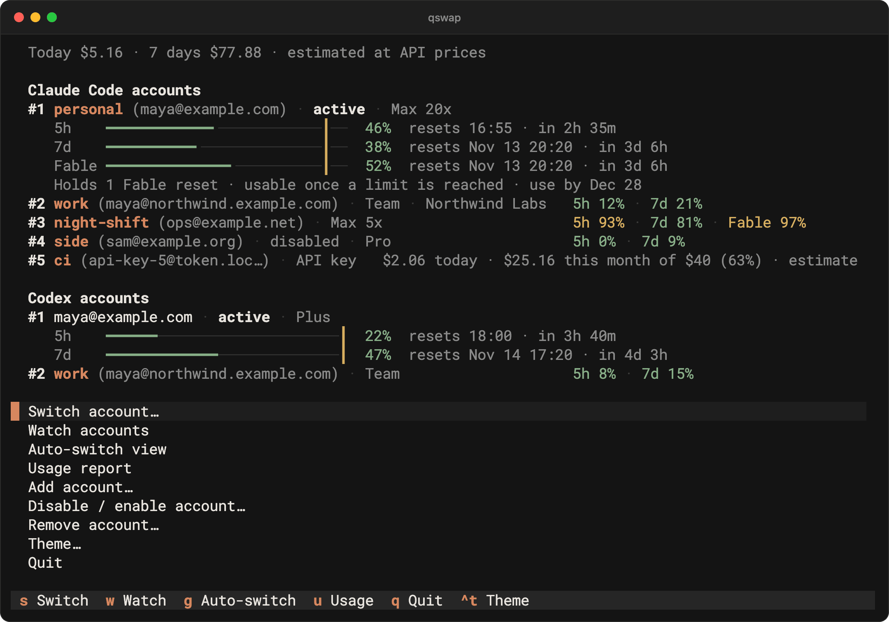
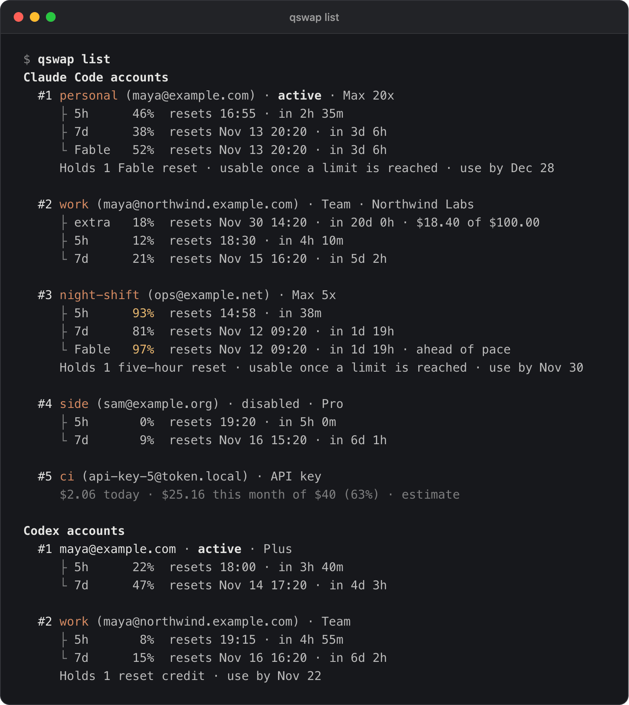
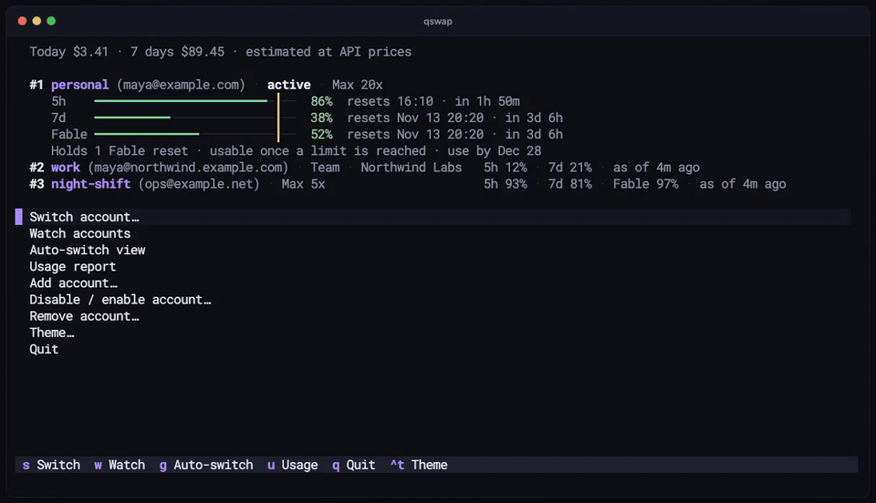
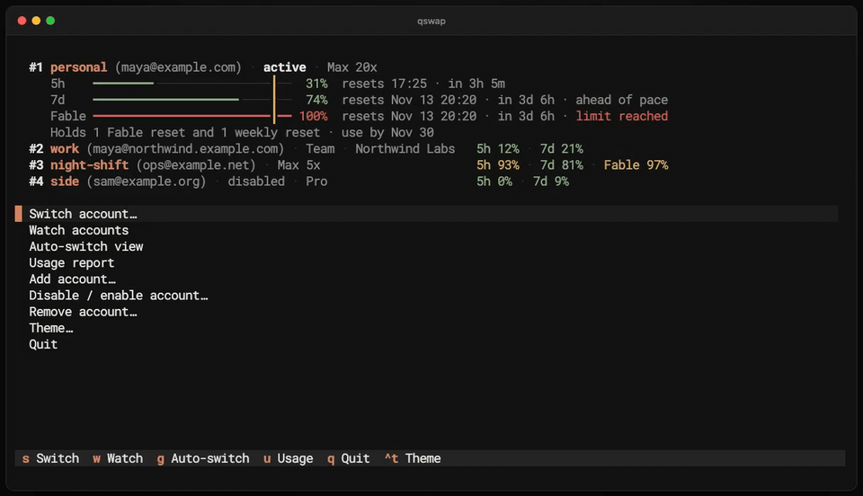

# ai-quota-swap

`qswap` keeps several Claude Code and Codex accounts on one machine, shows how much quota each one has left, and switches between them by hand or before the active one runs out.



## What it does

- Shows every account's 5-hour, weekly and per-model usage, plan, held resets and API spend: `qswap list`.
- Switches accounts without logging out, by hand or automatically at a line you set: `qswap switch`, `qswap auto`.
- Spends usage resets of the right kind when they help most: `qswap reset`.
- Runs Claude Code as a different account in one terminal while the others keep theirs: `qswap run`.
- Counts tokens and their estimated API cost per account, model and project, and holds API keys to a monthly budget: `qswap usage`, `qswap budget`.
- Puts all of it in a terminal dashboard (`qswap`) and a macOS menu bar app (`qswap menubar`).

Codex support (`qswap codex ...`) is experimental: it has been tested against fakes, not yet with two real Codex accounts.

## Install

ai-quota-swap is not on PyPI yet; a release there is coming. Install it from the repository with uv or pipx:

```bash
uv tool install git+https://github.com/seangeng/ai-quota-swap
# or
pipx install git+https://github.com/seangeng/ai-quota-swap
```

You need:

- Python 3.12 or newer.
- macOS, Linux (WSL included) or Windows. The menu bar app is macOS only. On macOS, saved logins go in the login Keychain; on Linux and Windows, in files in qswap's data directory.
- Claude Code, logged in. Codex is optional.

To update, run `qswap upgrade`. It runs `uv tool upgrade ai-quota-swap` or `pipx upgrade ai-quota-swap`, whichever installed it; on Windows it prints that command for you to run.

## Quick start

Log in to Claude Code with your first account, then save that login as an account:

```text
$ qswap add --alias personal
Added #1 personal (maya@example.com)
To add another account, log in to it in Claude Code (/login), then: qswap add
```

In Claude Code, run `/login` with your second account, then run `qswap add --alias work`. Go straight to `/login`: a `/logout` first may revoke the saved login of the account you leave. Repeat for every account you have.

`qswap list` shows them all:



Switch to another account by number, email or alias:

```text
$ qswap switch work
Switched #1 personal → #2 work (maya@northwind.example.com)
...
Claude Code picks up the new account within 30 seconds; restart it to apply now.
```

A running Claude Code session keeps working and moves to the new account on its own: within about 30 seconds on macOS, where the login is in the Keychain, and from its next message on Linux and Windows.

When something looks wrong, run `qswap doctor` first. It checks Claude Code, Codex, the data directory, the menu bar and auto-switch, and prints the command that fixes each problem. The [quick start guide](https://github.com/seangeng/ai-quota-swap/blob/main/docs/quickstart.md) walks through all of this in more detail.

## Switching automatically

`qswap auto` checks the active account every minute and switches before it runs out. Here the dashboard's auto view runs it live, and the active account climbs past its 90% line:



It switches at 90% by default (`qswap config set autoswitch.threshold 85` to change it) and moves to the account with the most quota left. Other strategies use up first the weekly quota that resets soonest, or follow an order you set. `--dry-run` says what it would do without doing it, and `qswap auto --once` checks once and reports the outcome in its exit code, for cron. Details, strategies and running it as a service: [docs/auto-switch.md](https://github.com/seangeng/ai-quota-swap/blob/main/docs/auto-switch.md).

## Usage resets

Anthropic grants some plans banked usage resets (Claude Code's `/limit-reset`). Each one refills the windows it clears to 0% and is lost if unused by its date. Resets come in kinds, and spending the wrong one wastes it:

| Kind | Clears |
|---|---|
| Fable reset (or another model's) | that model's weekly window |
| five-hour reset | the 5-hour window |
| weekly reset | the all-models weekly window |
| full reset | the 5-hour and the weekly windows; every Codex reset credit is one |



`qswap reset` lists what each account holds and what auto mode would spend now; `qswap reset 1` spends one on account 1, the narrowest kind that clears a window at 95% or more. While auto-switch runs, it spends resets by itself when switching cannot help (`resets.auto last-resort`, the default), at most 3 a day for each provider. Modes and guards: [docs/resets.md](https://github.com/seangeng/ai-quota-swap/blob/main/docs/resets.md).

## Codex accounts

Codex has the same commands under `qswap codex`:

```bash
qswap codex add      # save the Codex login you are using
qswap codex login    # log in another account without signing the first one out
qswap codex switch 2
qswap codex auto     # switch when the active account is out (99% by default)
```

Add further accounts with `qswap codex login`, not plain `codex login`, which signs the active login out first. Never run `codex logout` on a login qswap saved. This part is experimental: switching and reset credits have been tested against fakes only. Read [docs/codex.md](https://github.com/seangeng/ai-quota-swap/blob/main/docs/codex.md) before your first Codex switch.

## Usage and cost

`qswap usage` reads the session files Claude Code and Codex write on this machine and prices the tokens at API list prices. Only `--billed`, which asks Anthropic what it billed an organization, uses the network.

```text
$ qswap usage --by model
Token usage, 2026-11-04 to 2026-11-10, Claude Code and Codex, by model

  Model              Input  Output  Cache read  Cache write  Est. cost
  claude-opus-5-5     573K    948K       44.1M         2.2M     $41.14
  claude-sonnet-5-5   580K    918K       43.4M         2.3M     $20.35
  claude-fable-5-2   93.0K    164K        7.3M         384K     $12.62
  gpt-6.1-sol         826K    170K        2.4M            0      $3.60
  claude-haiku-5-5   74.0K    130K        5.7M         303K      $0.17
  Total               2.1M    2.3M        103M         5.2M     $77.88
```

Group by day, account, model, project, provider or session with `--by`. A subscription is not billed per token, so for subscription accounts the figure measures value used, not a bill. More: [docs/usage.md](https://github.com/seangeng/ai-quota-swap/blob/main/docs/usage.md).

## API accounts and budgets

Add a Console API key as an account with `qswap add-token sk-ant-api03-...`. Its row shows what it spent today and this month instead of usage windows, and `qswap budget 5 40` gives it a monthly budget:

```text
  #5 ci (api-key-5@token.local) · API key
     $2.06 today · $25.16 this month of $40 (63%) · estimate
```

At its budget, auto-switch stops using the account. The budget is a brake inside qswap, not a cap at Anthropic. Spend is estimated from this machine's sessions, or read from Anthropic's usage report once you register the organization's Admin key with `qswap api org add`. More: [docs/api-accounts.md](https://github.com/seangeng/ai-quota-swap/blob/main/docs/api-accounts.md).

## Several accounts at once

`qswap run 2` starts Claude Code as account 2 in this terminal only; the active account and every other terminal keep theirs. Sessions share your `~/.claude` settings and chat history. `qswap map 2 ~/work/client-app` makes a bare `qswap run` in that directory, or any directory below it, start account 2. `qswap run` is experimental. More: [docs/sessions.md](https://github.com/seangeng/ai-quota-swap/blob/main/docs/sessions.md).

## The dashboard

Run `qswap` with no arguments in a terminal (or `qswap tui`) for the dashboard shown at the top of this page. `s` switches, `w` watches every account, `g` opens auto-switch for each provider, `u` shows the usage report, `esc` goes back and `q` quits. `qswap watch` opens straight on the watch page. It runs on macOS, Linux and Windows. More: [docs/dashboard.md](https://github.com/seangeng/ai-quota-swap/blob/main/docs/dashboard.md).

## The menu bar (macOS)

```bash
uv tool install --force 'ai-quota-swap[menubar] @ git+https://github.com/seangeng/ai-quota-swap'
qswap menubar                 # start it now and at every login
qswap menubar --auto-switch   # let it switch Claude Code accounts for you
```

It shows every account's usage and today's cost, and switches with a click. Its auto-switch is off until you turn it on, per provider. This build of the menu bar has not yet been run by hand on a Mac; it is tested through its menu description and unit tests. More: [docs/menubar.md](https://github.com/seangeng/ai-quota-swap/blob/main/docs/menubar.md).

## Scripting

Add `--json` to `list`, `status`, `switch`, `reset`, `priority`, `config`, `usage`, `budget` or `doctor` for one JSON object on stdout; `qswap auto --json` prints one event per line. Every payload has a `schemaVersion`, and payloads only gain fields.

| Exit code | Meaning |
|---|---|
| `0` | success; for `auto --once`, it switched |
| `1` | failure; under `--json`, the error is on stdout |
| `2` | `auto --once`: nothing to do |
| `3` | `auto --once`: a switch was needed but no account can take over |
| `64` | usage error: unknown command, bad flag, missing argument |
| `130` | interrupted (Ctrl-C) |

A command that asks before it changes something (`remove`, `purge`, `reset N`) stops without a terminal unless you pass `--yes`. Field reference: [docs/json-output.md](https://github.com/seangeng/ai-quota-swap/blob/main/docs/json-output.md).

## What it stores and what it talks to

qswap keeps saved logins in the macOS login Keychain, or in files in its data directory on Linux and Windows, and everything else in that directory (`~/.ai-quota-swap`, or `~/.local/share/ai-quota-swap` on Linux). It talks to Anthropic and OpenAI with each account's own token, and once a day it checks PyPI for a newer version; there is no telemetry and no qswap server. It reads usage and spends resets through endpoints the vendors do not document, which can change without notice. Reading reset status identifies as Claude Code, because Anthropic reports resets only to Claude Code. [SECURITY.md](https://github.com/seangeng/ai-quota-swap/blob/main/SECURITY.md) lists every file and endpoint, and how to remove everything with `qswap purge`.

## Coming from claude-swap

ai-quota-swap started as a fork of claude-swap and keeps its own data, so it starts empty. Stop claude-swap's menu bar and any `cswap auto` first, then move your accounts across:

```bash
cswap export ~/claude-swap-export.json
qswap import ~/claude-swap-export.json
rm ~/claude-swap-export.json    # it holds your logins in plain text
```

Do not run both tools against the same accounts. Steps, what an export carries, and removing claude-swap: [docs/coming-from-claude-swap.md](https://github.com/seangeng/ai-quota-swap/blob/main/docs/coming-from-claude-swap.md).

## Documentation

- [Quick start](https://github.com/seangeng/ai-quota-swap/blob/main/docs/quickstart.md): from nothing to two accounts and a switch.
- [Switching automatically](https://github.com/seangeng/ai-quota-swap/blob/main/docs/auto-switch.md): strategies, lines, the log, cron and services.
- [Usage resets](https://github.com/seangeng/ai-quota-swap/blob/main/docs/resets.md): the kinds, when auto mode spends each, the guards.
- [Codex accounts](https://github.com/seangeng/ai-quota-swap/blob/main/docs/codex.md): adding, switching, what a switch does to running sessions.
- [Usage and cost](https://github.com/seangeng/ai-quota-swap/blob/main/docs/usage.md) and [API accounts and budgets](https://github.com/seangeng/ai-quota-swap/blob/main/docs/api-accounts.md).
- [Several accounts at once](https://github.com/seangeng/ai-quota-swap/blob/main/docs/sessions.md): `run`, `map`, what sessions share.
- [The dashboard](https://github.com/seangeng/ai-quota-swap/blob/main/docs/dashboard.md) and [the menu bar](https://github.com/seangeng/ai-quota-swap/blob/main/docs/menubar.md).
- [Settings](https://github.com/seangeng/ai-quota-swap/blob/main/docs/settings.md), [JSON output](https://github.com/seangeng/ai-quota-swap/blob/main/docs/json-output.md) and [troubleshooting](https://github.com/seangeng/ai-quota-swap/blob/main/docs/troubleshooting.md).
- [Coming from claude-swap](https://github.com/seangeng/ai-quota-swap/blob/main/docs/coming-from-claude-swap.md).

`qswap help` lists the commands by task; `qswap help COMMAND` shows one command's options and examples. What changed is in the [changelog](https://github.com/seangeng/ai-quota-swap/blob/main/CHANGELOG.md), what comes next in the [roadmap](https://github.com/seangeng/ai-quota-swap/blob/main/ROADMAP.md).

## Contributing

[CONTRIBUTING.md](https://github.com/seangeng/ai-quota-swap/blob/main/CONTRIBUTING.md) covers setup, running qswap against invented accounts, the tests and the lint. The code map is in [docs/architecture.md](https://github.com/seangeng/ai-quota-swap/blob/main/docs/architecture.md). Report security problems privately, as [SECURITY.md](https://github.com/seangeng/ai-quota-swap/blob/main/SECURITY.md) describes.

## License

MIT. See [LICENSE](https://github.com/seangeng/ai-quota-swap/blob/main/LICENSE).

Built on [claude-swap](https://github.com/realiti4/claude-swap) by Onur Cetinkol.
