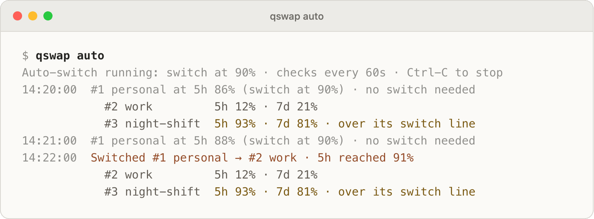

# Switch accounts automatically

`qswap auto` watches the active account's usage and switches to another account before it runs out. After reading this page you can pick a strategy, set switch lines, read the log, and leave the engine running unattended.

## Start it

```text
$ qswap auto
Auto-switch running: switch at 90% · checks every 60s · Ctrl-C to stop
14:20:00  #1 personal at 5h 86% (switch at 90%) · no switch needed
            #2 work         5h 12% · 7d 21%
            #3 night-shift  5h 93% · 7d 81% · over its switch line
14:21:00  #1 personal at 5h 88% (switch at 90%) · no switch needed
14:22:00  Switched #1 personal → #2 work · 5h reached 91%
            #2 work         5h 12% · 7d 21%
            #3 night-shift  5h 93% · 7d 81% · over its switch line
```

<picture>
  <source media="(prefers-color-scheme: dark)" srcset="../assets/screenshots/raw/auto.png">
  
</picture>

It runs in the foreground until you press Ctrl-C. Other ways to run it:

```bash
qswap auto --dry-run --verbose   # say what it would do; never switch or spend a reset
qswap auto --once; echo $?       # one check; the outcome is the exit code
qswap auto --threshold 85 --weekly-threshold 97
```

Flags override the [settings](#settings) for that run only. A value out of range is clamped, with a warning such as `Warning: --interval 5 is out of range; using 15s`.

After a switch to a subscription account, a running Claude Code picks up the new login within about 30 seconds on macOS (its Keychain cache) and from its next message where the login is kept in a file. A move to an API key reaches running sessions about a second after qswap writes the key line into Claude Code's settings (measured on Claude Code 2.1.322; [below](#api-key-accounts-and-budgets)). The default line is 90 rather than 95 to cover that delay and a heavy turn that keeps spending meanwhile. Switches take the same credential locks Claude Code uses, so a switch never lands in the middle of Claude Code refreshing its token.

## How it picks the next account

Choose a strategy with `--strategy NAME` or `qswap config set autoswitch.strategy NAME`.

`best` (the default) stays on the active account until one of its windows reaches its switch line, then moves to the account with the most room left under its own lines.

`weekly-first` switches at the same moment as `best` and lands only where `best` could. Among the accounts that qualify, it picks the one whose weekly window resets soonest, so weekly quota that would expire unused is spent first. When it has to escape (the active account at its limit, or its usage unreadable) it ranks by room left, as `best` does.

`consume-first` does not wait for the line. Whenever another account with room has a weekly window that resets sooner than the active account's, it moves there. While the active account's weekly reset time is unknown it stays put, and the log says `no weekly reset known yet`.

`priority-consume-first` follows the tiers you set with `qswap priority`: the highest tier that has an account under all of its lines, then the soonest weekly reset within that tier. It moves back up as soon as a higher-tier account is usable again, after the cooldown. It never lands on an account at or over a switch line, even when the active account is at its limit; it holds and keeps checking instead.

For a one-off pick by hand, `qswap switch --strategy best` jumps to the account with the most quota left (and stays put if it cannot prove one has more), and `qswap switch --strategy next-available` moves to the next account in order, skipping any at their limit. Both skip disabled accounts and accounts that need re-login, and both count the per-model limits in `autoswitch.model` unless you pass `--model`.

## Switch lines

A switch line is the percent used at which auto-switch leaves an account. Every window is compared against its own line, and the window closest to its line decides. The log quotes that comparison: `#1 personal at 5h 86% (switch at 90%)`. A line is where the engine starts looking, not a hard cap: with no account under its lines, every strategy except `priority-consume-first` still moves to the account with the most room (see [Cooldown and hysteresis](#cooldown-and-hysteresis)).

- **The global line**, `autoswitch.threshold` (default 90; `--threshold`), applies to the 5-hour window, and to every window while no weekly line is set.
- **The weekly line**, `autoswitch.weeklyThreshold` (unset; `--weekly-threshold`), takes over the weekly window and any per-model window, leaving the global line to the 5-hour window. The 5-hour window refills in hours, so running past its line costs a turn; the weekly window is your budget for the week, so you may want to run it closer to full: `qswap config set autoswitch.weeklyThreshold 97`. `qswap config unset autoswitch.weeklyThreshold` goes back to one line.
- **A line per account**, set with `qswap threshold` (50 to 99.9), replaces the global line for that account. With a weekly line set, it applies to that account's 5-hour window only. `qswap threshold 3 --unset` removes it.

  ```text
  $ qswap threshold 3 85
  Set the switch line of #3 night-shift (ops@example.net) to 85%
  $ qswap threshold
  Switch lines
    default (autoswitch.threshold)  90%
    #3 night-shift (ops@example.net)  85%
  ```

- **Priority tiers**, set with `qswap priority 2 5` (a whole number from 0 to 1000; default 0), are read only by `priority-consume-first`. `qswap priority` lists them and `qswap priority 2 --unset` returns an account to 0.
- **Per-model limits.** By default only the 5-hour and weekly windows count. If you run into a model's own weekly limit first, add `--model Fable` or `qswap config set autoswitch.model Fable` and that window counts too. Use the names of the per-model rows in `qswap list` (case does not matter); separate several with commas, or give `all`. A name that no account reports gets one `Warning:` line in the log.
- **Accounts with no 5-hour window.** When the usage API reports no 5-hour window for an account (an Ultra plan has none), it is judged on its weekly window and any `--model` windows alone.

## Cooldown and hysteresis

Four rules keep the engine from bouncing between accounts.

- **Cooldown.** After an automatic switch, the engine waits `autoswitch.cooldownSeconds` (default 300; `--cooldown`) before the next switch made at a line; the log says `cooling down, 4m left`. Leaving an account that is at its limit, over its budget, or unreadable does not wait.
- **Hysteresis.** Under `best` and `weekly-first`, a switch made at the line lands only on an account that is under all of its own lines and has at least `autoswitch.hysteresisPct` (default 10) points more room than the active account. Two accounts close to the line never trade places.
- **No straight return.** After a switch made at the line, the engine does not go back to the account it left until that account has recovered: more room than when it was left, or a reset that came nearer. A switch you make by hand lifts this.
- **Everyone over the line.** When the active account and every other account are at or over their lines, there is nowhere healthy to land, so `best`, `weekly-first` and `consume-first` move to the account with the most room before a limit, once it has twice the active account's remaining room or 3 points more, whichever is less. `priority-consume-first` holds.

When every account is at its limit, the log says `All accounts are at their limit; the first resets 15:32 · in 1h 12m`, and the engine sleeps until that reset, checking at least every 10 minutes because quota can come back early.

If an account holds a usage reset, the engine may spend it instead of switching, under the `resets.*` settings ([resets.md](resets.md)).

## Holding accounts out

`qswap disable 4` holds an account out of rotation: auto-switch and a bare `qswap switch` skip it, and `qswap switch 4` can still pick it. `qswap enable 4` puts it back. The log lists it as `disabled`.

Auto-switch also skips an account that a running `qswap run` session is using ([sessions.md](sessions.md)).

## API-key accounts and budgets

An API-key account has no usage windows, so auto-switch never ranks it against subscriptions, and the log lists it as `API key, not used`. By default, when you switched to an API-key account, the engine leaves it there: `#5 ci is an API key · on the API key you chose`.

`--include-api-key-accounts` (or `autoswitch.includeApiKeyAccounts true`) makes API-key accounts a last resort. The engine moves to one through the key line in Claude Code's settings, so running sessions follow it and do not hold the move ([api-accounts.md](api-accounts.md#switch-to-an-api-key)). It does so only when all of these hold:

- the active subscription is at its limit and no other subscription can take over. A switch line is not enough, and neither is usage that cannot be read. A subscription with at least 5 points of room in every window it is judged by can take over, even over its own switch line and with any `--strategy`; the engine moves there instead and says why: `Switched #1 personal → #3 night-shift · 5h limit reached; taken over its switch line (5h 95%) before an API key`;
- no other subscription's usage is unreadable this check, for up to one cooldown from the first check that wanted the key; then the key goes ahead. The log says so once: `Not switching to an API key yet: #3 night-shift's usage could not be read this check; waiting up to 5m for it` (`usage-unreadable-hold`);
- no usage reset is being spent this check. The order is exact: a reset auto mode spends (`resets.*`, [resets.md](resets.md)), or one whose answer or refill is still out, comes before a key. A reset auto mode keeps stays banked, and the switch names it, one line per account, with the reason and the command that spends it: `Switched #1 personal → #5 ci · 7d limit reached; #1 personal holds 1 weekly reset auto mode keeps (its 7d window refills in 9h); to spend it instead: qswap reset 1`. The reasons are the settings that say when a reset is worth spending: its window refills within `resets.minHoursLeft` (`its 7d window refills in 9h`), today's limit on automatic resets is reached, `resets.auto active` spends resets of the active account only, a weekly reset is kept when only a model window is full (`resets.weeklyForModelLimit`), and `resets.auto off`. A dry run says the same, and JSON has them in the switch event's `resetsKept`. While the key auto-switch entered is active, `qswap status`, `qswap list`, the dashboard and the menu bar repeat each line for as long as it is true (`reset-kept` in `keyNotes`, [json-output.md](json-output.md#list-and-status));
- the key has a monthly budget or a credit. Without one it is never used, and the log says so once: `Not switching to an API key: #5 ci has no budget or credit; set one with: qswap budget 5 AMOUNT`;
- its spend figure is no older than 20 minutes. The engine reads this machine's session files itself before it moves (and every 5 minutes while a key with a budget or credit is active), so this matters only when that fails or the figure comes from Anthropic and is late: `Not switching to #5 ci: its spend could not be measured for 20 minutes; check it with: qswap usage`. A dry run (`--dry-run`) writes nothing, the usage ledger included, so it judges the figure as it stands and says that a real run measures it first: `Not switching to #5 ci: its spend could not be measured for 20 minutes. A real run measures it first, and this dry run's figure may be older, so a real run may move to it; check it with: qswap usage`. A dry run also checks, reading only, that the key's slot holds a key, and says so when it does not, as a real run would (`key-unusable`).

Here every subscription is at its limit and `#5 ci` has a $40 budget:

```text
$ qswap auto --once
14:20:00  Switched #1 personal → #5 ci · 5h limit reached
            #2 work         5h 100% · 7d 21% · limit reached
            #3 night-shift  5h 100% · 7d 81% · limit reached
            #4 side         disabled
            #5 ci           API key, used as a last resort
```

Who moved to the key decides when the engine leaves it:

- A key the engine moved to is left for a subscription once that subscription is under its own lines with at least 5 points of room in every window, and the cooldown has passed since the move (`Switched #5 ci → #1 personal · a subscription has room again`; the trigger is `key-return` in JSON). Until then it logs `on the API key until a subscription has room` (`no-subscription-room`).
- A key you switched to yourself is never left because a subscription has room (`on the API key you chose`, `active-api-key`).
- A key the engine moved to is also left at once when you turn `autoswitch.includeApiKeyAccounts` off, as when its budget is removed (a running engine, the menu bar's included, reads the setting again at each check; one started with `--include-api-key-accounts` or `--no-include-api-key-accounts` keeps what its flag says): for the subscription with the most room, else back to the account underneath (`Switched #5 ci → #1 personal · API keys are turned off (autoswitch.includeApiKeyAccounts); no subscription has room, so back to the account underneath`). A key you switched to yourself is not touched.
- Either kind is left at once, without waiting for the cooldown, at its budget, with its credit spent or expired, or when its spend has not been measured for 20 minutes (`spend-unknown`): for the subscription with the most room, and when none has room, back to the account underneath, said once: `Switched #5 ci → #1 personal · monthly budget reached (estimate); no subscription has room, so back to the account underneath`. A budget or credit once reached stays reached in the engine's state, even if a later figure reads lower: a budget until the month rolls over or you set the budget again, a credit until you record another. Each command clears only its own, so recording a credit does not undo a budget reached this month. The key's row then ends in `budget reached earlier` (or `credit counted as spent`), and the log says once: `Not switching to #5 ci: its monthly budget was reached this month, and a lower figure since does not undo that. To use it again, set the budget again: qswap budget 5 AMOUNT` (`limit-latched`).
- It never moves from one key to another, and never switches the login over a login qswap does not manage: under such a login, at the key's limit, it only removes the line. After it leaves a key at its limit for a subscription that is itself full, it enters no other key until a subscription has room again, and says so once: `Not switching to another API key: auto-switch left #5 ci at its monthly budget, and enters no other key until a subscription has room. To use #6 build now: qswap switch 6` (`key-left`; the other keys' rows read `API key, not used until a subscription has room`). The key it left may come back once its own figure allows it (a fresh spend figure after `spend-unknown`).
- With no login at all under the key, it stays and says so once, with the command that leaves: `Staying on #5 ci past its monthly budget: no login is under the key to go back to. Leave it with: qswap switch 1` (`stuck-on-key`).

When qswap cannot add the key line (another `apiKeyHelper` is set, a credential variable is in the settings' `env` block, or the settings file cannot be parsed), the engine does not take the `--log-out-sessions` way by itself. It stays, logs `not moving to an API key, its key line cannot be added`, and the menu bar notifies once: `Not switching to #5 ci: qswap cannot add its key line to Claude Code's settings; see why with: qswap doctor`. In JSON the reason is `key-helper-unavailable`. A slot that cannot give a key (its saved credential is not one) is skipped for the next key, and reported once (`key-unusable`). When the settings file cannot be read while a key qswap made active is recorded, the engine stops switching and says so once (`settings-unreadable`; `auto --once` exits 3).

Each check, except a dry run, first runs the same repair `qswap switch` runs: a run profile still sharing the settings gets its copy, a record whose line is gone is cleared, and so on ([api-accounts.md](api-accounts.md#what-qswap-doctor-checks)). A line that names another data directory (`--data-dir`), or on macOS and Windows a line with none while this qswap runs with another data directory, belongs to another qswap: it is left alone, and the engine does not move to a key while it is there. Each repair is written to qswap's log file ([troubleshooting.md](troubleshooting.md#where-the-log-file-is)); one made by a check that switches is also in that switch's `warnings`.

When the engine stops on a key it entered (Ctrl-C, the menu bar's toggle off or quit), it moves nothing and says: `Sessions stay on #5 ci, which auto-switch entered; nothing watches its limit now. To go back: qswap switch 1`. A restarted engine carries on with the key. Until then `qswap status`, `qswap list`, the dashboard, the menu bar and `qswap doctor` say that nothing watches its limit. A dry run does not count as watching, since it never leaves a key: with only a dry run running (the dashboard starts its engines in dry run) they say `Auto-switch entered #5 ci and only a dry run is running, so nothing watches its limit. To go back: qswap switch 1`. A `qswap auto --once` tick counts for 15 minutes, for the cron setup below: the note then reads `Auto-switch entered #5 ci and last checked it 4m ago (qswap auto --once).` and doctor does not warn. After that it is the usual note, with when it last checked: `... so nothing watches its limit; it last checked 20m ago. To go back: qswap switch 1`.

An API-key account made active the older way (`qswap switch 5 --log-out-sessions`) is not on the key line; there the engine counts its usage as unreadable with this setting on (`#5 ci is an API key · failover in 2 more checks`) and, after `autoswitch.unhealthyTicks` checks, moves to an account with room. Its budget and credit apply as above.

A monthly budget (`qswap budget 5 500`), or a credit (`qswap credit 5 1187`, [api-accounts.md](api-accounts.md#record-a-prepaid-credit)), applies to a key you chose too; whichever is reached first applies. From 80% of the budget the log prints one budget warning a month (`budget-warning` in JSON), for example `#5 ci has spent $25.22 of its $30.00 monthly budget (84%) (estimate)`. Here `#5 ci` is active with $25.22 spent against a $20 budget:

```text
$ qswap auto --once
14:20:00  #5 ci has spent $25.22 of its $20.00 monthly budget (126%) (estimate)
14:20:00  Switched #5 ci → #2 work · monthly budget reached (estimate)
            #1 personal     5h 46% · 7d 38%
            #2 work         5h 12% · 7d 21%
            #3 night-shift  5h 93% · 7d 81% · over its switch line
            #4 side         disabled
```

How spend is measured (`(estimate)` marks a figure worked out on this machine), and what a budget does not do, is in [api-accounts.md](api-accounts.md).

## When something fails

The engine keeps running through failures and does not switch on a guess.

- **Stale readings.** A reading counts while it is under 5 minutes old. While refreshing it fails, or while qswap has scheduled the next read for later, it keeps counting for up to an hour (when the usage endpoint is rate limiting, until the window resets). Past that the account's usage is unknown and it cannot be picked; the log shows the old figures with their age, as in `as of 3h 4m ago (timed out)`.
- **The active account unreadable.** After `autoswitch.unhealthyTicks` checks in a row without a reading (default 3), the engine fails over to any account with room, without waiting for the cooldown. Until then the log counts down: `failover in 2 more checks`.
- **An expired token on an idle machine.** Claude Code refreshes its token when you next send a message, so an expired token on the active account usually means nobody is working. The engine holds (`Claude Code is idle, resumes on next use`) and checks every 5 minutes. After 30 minutes of this it treats the account as unreadable, in case its refresh token is dead.
- **A saved login that was refused.** Before switching, the engine refreshes the target's token if it expires within 10 minutes. If the refresh is refused, the account is set aside and shows `needs re-login` in the log, `qswap list`, `qswap status`, the dashboard and the menu bar. Log in to it in Claude Code (`/login`) and run `qswap add`; the engine puts it back by itself and logs `#4 side is back in rotation (login replaced)`.
- **No account can take over.** The check names each account's reason and the next step:

```text
$ qswap auto --once
14:20:00  #1 personal at 5h 100% (limit reached) · nothing to switch to
            #2 work         needs re-login
            #3 night-shift  usage unavailable (HTTP 503), retrying
            #4 side         needs re-login
            #5 spare        5h 40% · 7d 55% · as of 3h 4m ago (timed out)
            To use #2 work and #4 side again, log in to each in Claude Code
            (/login), then run: qswap add
```

## Reading the log

Each check prints one line: the time, the active account, the window closest to its line against that line, and the decision. A switch gives its reason in words: `5h reached 91%` (a line), `limit reached`, `usage unreadable` (failover), `its weekly window resets sooner` (`consume-first`), `higher priority` (`priority-consume-first`), and for an API key `a subscription has room again`, `monthly budget reached`, `credit spent`, `credit expired` or `its spend could not be measured for 20 minutes`; `(estimate)` follows a figure worked out on this machine.

The indented lines under a check give each other account's windows, or why it cannot be used: `over its switch line`, `limit reached`, `needs re-login`, `disabled`, `usage unavailable (HTTP 503), retrying`, `API key, not used`, `API key, used as a last resort`; with `--include-api-key-accounts`, a key the engine would not move to says why: `API key, no budget or credit, not used`, `API key, monthly budget reached`, `API key, credit spent`, `API key, credit expired`, `API key, budget reached earlier, not used`, or (a dry run, which does not measure the spend) `API key, limit not enforced: no spend figure`. They print on the first check, whenever a switch is being decided (the active account at or over its line, a switch, or no account able to take over), and on every check with `--verbose`.

Other events get a line of their own: errors (`Error: ... (will retry)`), long sleeps (`Sleeping 12m, until 14:32`), accounts set aside or back in rotation, usage resets spent, warnings and budget warnings. Lines fit 80 columns and carry no colour when the output is not a terminal.

`--json` prints one JSON event per line instead, each with `schemaVersion` and an `event` kind (`poll`, `switch`, `no-switch`, `account-quarantined`, `all-exhausted`, `budget-warning`, and others). The fields are in [json-output.md](json-output.md).

## Running it unattended

### macOS: the menu bar

The menu bar app hosts the same engine, one per provider, with the same settings. `qswap menubar --auto-switch` turns it on for Claude Code. See [menubar.md](menubar.md).

### Linux: a systemd user service

An example unit, not yet run against real accounts. `ExecStart` needs the absolute path of `qswap`; `command -v qswap` prints it.

```ini
# ~/.config/systemd/user/qswap-auto.service
[Unit]
Description=qswap auto-switch

[Service]
ExecStart=/home/you/.local/bin/qswap auto
Restart=on-failure
RestartSec=30

[Install]
WantedBy=default.target
```

```bash
systemctl --user daemon-reload
systemctl --user enable --now qswap-auto
journalctl --user -u qswap-auto -f      # the log
```

If your shell sets `CLAUDE_CONFIG_DIR`, `CODEX_HOME` or `XDG_DATA_HOME`, set the same values in the unit with `Environment=`. Use a user unit: qswap refuses to run as root outside a container. A user service stops when you log out unless lingering is on (`loginctl enable-linger`).

`qswap auto` loops until it is stopped. On SIGTERM (`systemctl --user stop qswap-auto`) it finishes the check in progress and exits with 0, so `Restart=on-failure` leaves it stopped. Ctrl-C prints `Auto-switch stopped.` and exits with 130.

### cron

`--once` runs one check and exits, and `--json` makes the log one event per line:

```text
*/5 * * * * /home/you/.local/bin/qswap auto --once --json >> ~/qswap-auto.log 2>&1
```

cron's `PATH` usually does not include the directory qswap is installed in, so give the absolute path. Cooldown, set-aside accounts and the failover count are kept in a state file, so separate `--once` runs behave like one loop. Between runs nothing watches, so a five-minute schedule reacts later than the loop does; a key auto-switch entered counts as watched while the last `--once` run is under 15 minutes old. On macOS, cron has not been tested with saved logins in the login Keychain; use the menu bar.

### Is it running?

Each engine writes `autoswitch_heartbeat.json` in the data directory (Codex's in `codex/` inside it) after every check, a dry run too. `qswap status` and `qswap doctor` read it:

```text
$ qswap status
...
Auto-switch is running for Claude Code; last check just now.
```

Only a looping engine (`qswap auto`, `qswap codex auto` or the menu bar) counts as running. A `--once` run from cron shows as `not running · last ticked 3m ago` in `qswap doctor`. The heartbeat is not removed when an engine stops, so for a few minutes afterwards (until its announced next check plus two minutes) `qswap status` still says it is running.

### Exit codes

| Code | Meaning |
|---|---|
| `0` | `--once`: switched (with `--dry-run`: would switch). The loop: stopped by SIGTERM |
| `1` | an error: the check failed (network trouble, no target's token could be refreshed), or qswap could not start (Codex with no accounts, run as root) |
| `2` | `--once`: nothing to do: no switch needed, cooling down, a switch deferred, or no active account qswap manages |
| `3` | `--once`: blocked: a switch is wanted but no account can take over, or the settings that hold the key line of a key qswap made active cannot be read |
| `64` | a usage error: unknown flag, bad value |
| `130` | interrupted with Ctrl-C |

## Codex

`qswap codex auto` runs the same engine over your Codex accounts, with the same flags, log and exit codes, and its own cooldown, set-aside list and failover count in `codex/` inside the data directory. What differs:

- Its line is `codex.threshold` (default 99) instead of `autoswitch.threshold`, because a Codex switch restarts Codex's background server and interrupts work in progress. By default it moves only when the active account is out. Every other `autoswitch.*` setting applies to both providers.
- A saved Codex login whose token has expired reads `usage unknown until used` and is never picked automatically. `qswap codex switch N` picks it, and Codex renews the token the next time it runs; qswap never refreshes a Codex login.
- When a running Codex may be renewing the active login's token, the switch waits (`switch deferred, retrying`) and the next check tries again.
- `--include-api-key-accounts` does not apply.

More in [codex.md](codex.md).

## Settings

Change one with `qswap config set autoswitch.cooldownSeconds 600`; remove it with `qswap config unset autoswitch.cooldownSeconds`. Flags override them for one run. A running engine reads `autoswitch.includeApiKeyAccounts` again at each check, unless a flag set it; the other `autoswitch.*` settings apply when it starts. The full list is in [settings.md](settings.md).

| Setting | Default | Meaning |
|---|---|---|
| `autoswitch.threshold` | `90` | Switch line for the 5-hour window, and for every window while no weekly line is set (50 to 99.9). `--threshold` |
| `autoswitch.weeklyThreshold` | (none) | Switch line for the weekly and per-model windows (50 to 99.9). `--weekly-threshold` |
| `autoswitch.intervalSeconds` | `60` | Seconds between checks (15 to 3600). `--interval` |
| `autoswitch.cooldownSeconds` | `300` | Least time between switches made at a line (0 to 86400). `--cooldown` |
| `autoswitch.hysteresisPct` | `10` | Points of room a target must have over the active account for a switch at the line (0 to 50) |
| `autoswitch.strategy` | `best` | `best`, `weekly-first`, `consume-first` or `priority-consume-first`. `--strategy` |
| `autoswitch.includeApiKeyAccounts` | `false` | Allow an API-key account with a budget or credit as a last resort, when every subscription is at its limit. `--include-api-key-accounts` |
| `autoswitch.unhealthyTicks` | `3` | Checks in a row without a reading of the active account before failover (1 to 100) |
| `autoswitch.model` | (none) | Per-model limits that also count, comma-separated, or `all`. `--model` |
| `codex.threshold` | `99` | `qswap codex auto`'s switch line, in place of `autoswitch.threshold` (50 to 99.9) |

## Limits

- A check every 60 seconds is not a usage request every 60 seconds. A check reads the active account and at most one other account when they are due, and reads every account only when the active one is within 15 points of a line or unreadable. A reading younger than 3 minutes is reused; the active account is read once a minute while it climbs within 15 points of its line; idle accounts and accounts at their limit are read about every 10 minutes. Request volume stays about flat however many accounts you manage.
- Codex switching has been tested only against fakes, never with two real Codex accounts.
- The latest menu bar build (both providers, auto-switch per provider) has not yet been run by hand.
- The systemd unit above has not been run against real accounts, and cron on macOS has not been tested.
