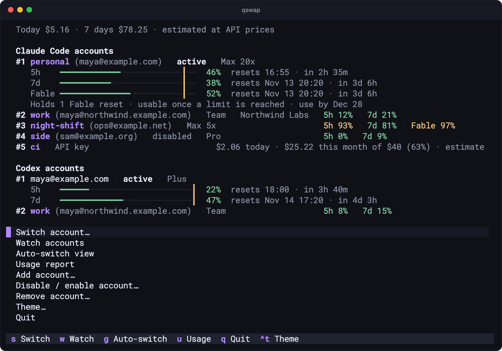
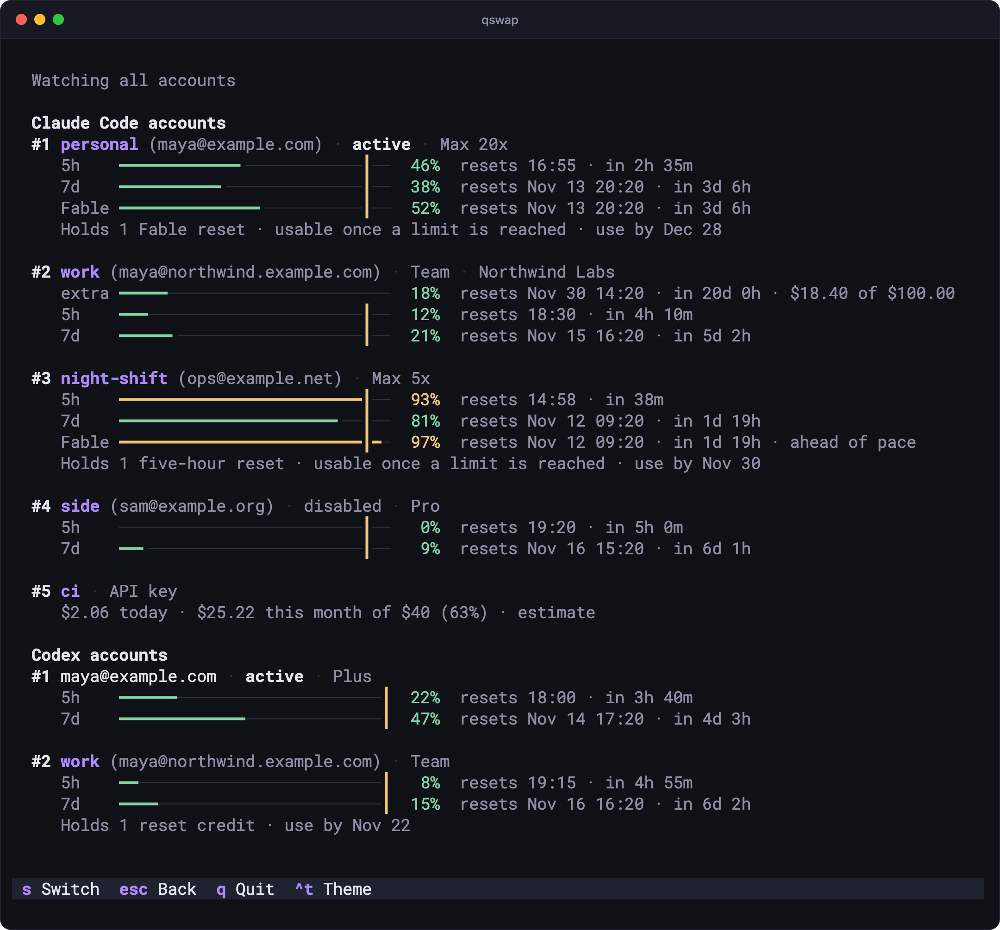
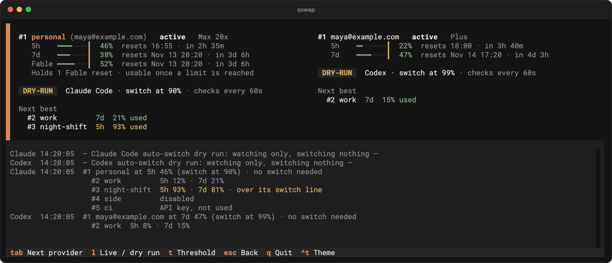
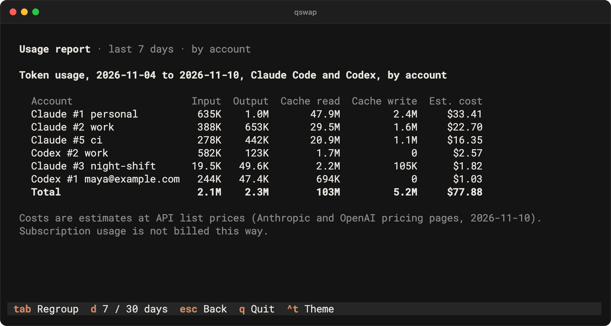

# Dashboard

The dashboard is a full-screen view of every Claude Code and Codex account in your terminal. From it you can switch accounts, watch usage as it changes, run auto-switch for a while, read the token and cost report, and add, disable or remove accounts. This page covers every screen and every key.

## Open it

| Command | Opens |
|---|---|
| `qswap` (no arguments, in a terminal) | the main screen |
| `qswap tui` | the main screen |
| `qswap watch` | the watch page; `esc` goes to the main screen |

Off a terminal (in a pipe, a script, cron), bare `qswap` prints a hint and exits 0:

```text
$ qswap
qswap switches between several Claude Code and Codex accounts.
  qswap help    the commands
  qswap list    your accounts and their usage
```

The dashboard runs on macOS, Linux and Windows. CI runs its tests on all three.

## The main screen



From the top:

- **The cost line**, `Today $17.21 · 7 days $180.55 · estimated at API prices`. It totals both providers at API list prices, the same figures `qswap usage` reports ([usage.md](usage.md)). It appears once the usage ledger holds anything for the last seven days. The dashboard reads new session files when it starts and every 5 minutes after that. A `+` after a figure means some tokens were of a model with no known price.
- **The accounts.** Each provider's accounts sit under a heading ("Claude Code accounts", "Codex accounts") when both providers have some. The active account is shown in full: its header, a bar per window (`5h`, `7d`, a model's own window such as `Fable`, `extra` for extra-usage spend) with a tick at the account's switch line, when each window resets, and the usage resets it holds ("Holds 1 Fable reset"). Every other account takes one line. An account that needs re-login gets a second line with the command that fixes it. The words match `qswap list`. A figure turns yellow at the account's switch line and red at its limit. An API-key account's spend takes the warning colour at its budget, with its credit spent or expired, and while its limit is not enforced (no spend figure from the last 20 minutes). With an API key active, the key's card says `over #1 personal` (and `by auto-switch` when the engine entered it), the subscription's row says `underneath`, and a note under the accounts says what `qswap list` says about the key line: a line that names an account with no key, one that came back, settings that cannot be read, or a key auto-switch entered while no engine runs, each with its command.
- **The menu.** The arrow keys move through the menu, not the accounts.

The screen reads the usage store every 3 seconds. Usage is fetched over the network only as often as the store allows, the same as `qswap list`. On a short terminal the screen gives up, in order, the held-reset sentences, the blank line between sections, the second line of rows that need re-login and the active accounts' bars. Last, it folds the final rows into `… 2 more · w shows every account`.

| Key | Does |
|---|---|
| `↑` `↓` (or `k` `j`) | move through the menu |
| `enter` | open the highlighted entry |
| `esc` or `←` | back out of a submenu |
| `s` | open the switch picker (offered when there is an account to switch to) |
| `w` | open the watch page (offered once an account is managed) |
| `g` | open the auto view (offered once an account is managed) |
| `u` | open the usage screen |
| `f` | read usage again now (the usage store still decides what is fetched) |
| `ctrl+t` | change the theme: dark, then light, then auto |
| `q` | quit |

| Menu entry | Does |
|---|---|
| `Add maya@example.com` | shown first when a provider is signed in with a login qswap does not manage; saves it after a confirmation (with both providers it ends in `· Claude Code` or `· Codex`) |
| Switch account… | the switch picker, as `s` |
| Watch accounts | the watch page, as `w` |
| Auto-switch view | the auto view, as `g` |
| Usage report | the usage screen, as `u` |
| Add account… | what each provider can add ([Add, disable, remove](#add-disable-remove)) |
| Disable / enable account… | every account; picking one disables or enables it |
| Remove account… | every account; picking one asks before it removes it |
| Theme… | dark, light or auto; `●` marks the setting in use |
| Quit | quit |

The menu never offers an action that cannot work. With nothing managed it has no switch, watch, auto-switch, disable or remove entry.

## First run

With no account managed, the accounts area says why and what to do. With Claude Code and Codex both signed in:

```text
No accounts are managed yet.
Claude Code is logged in as maya@example.com. Add it with: qswap add
Codex is logged in as maya@example.com. Add it with: qswap codex add
```

The menu then starts with `Add maya@example.com · Claude Code` and `Add maya@example.com · Codex`, followed by Usage report, Add account…, Theme… and Quit. Press `enter` on an Add entry and confirm, and the account appears. When Claude Code is not signed in, the sentence says `Claude Code is not logged in. Log in with claude (/login), then run: qswap add`. When it is not installed: `Claude Code was not found on PATH. Install it and log in, then run: qswap add`.

## Watch page (`w`)

Every account in full, both providers, updated as readings arrive. A row flashes when a new reading lands. The title is `Watching all accounts`. It adds `snapshot 2m ago` when the screen's last read is a minute old or more, and `refreshing 5s` when a read is slow. The page is read-only until you press `s`.



| Key | Does |
|---|---|
| `s` | arm selection: a cursor appears on the active account |
| `↑` `↓` (or `k` `j`) | scroll; with selection armed, move the cursor |
| `enter` | with selection armed, switch to the highlighted account and keep watching |
| `f` | read usage again now |
| `esc` | disarm selection; otherwise go back to the main screen |
| `q` | quit |

## Switch picker (`s`)

`Switch to which account?` lists every account in full, both providers. The cursor starts on the active account.

| Key | Does |
|---|---|
| `↑` `↓` (or `k` `j`) | move the cursor |
| `enter` | switch the highlighted account's provider to it, then go back |
| `b` | best pick: the account with the most quota left in the highlighted account's provider (`qswap switch --strategy best`), then go back |
| `esc` | go back without switching |
| `q` | quit |

A notification says `Switched to …`, along with any warning the command line would print (a stale or unreadable reading switches with a warning). An account that needs re-login is refused with the command line's explanation, in a dialog titled `Needs re-login`:

```text
#2 work needs re-login (its saved login was refused); not switched.
Log in to it in Claude Code (/login), then run: qswap add
```

The dialog starts on Cancel. Its other button, Switch anyway, does what `qswap switch 2 --anyway` does.

Switching to an API-key account asks nothing: the notification is `Switched to #5 ci` and the lines `qswap switch 5` prints after it (running sessions move to the key within a few seconds, claude.ai connectors and Remote Control are unavailable while a key is in use, `Go back with: qswap switch 1`). Only when qswap cannot add its key line to Claude Code's settings, and the older saved-key way is open, a dialog titled `Use the saved key instead?` shows the command line's explanation of what would happen to running sessions. It starts on Cancel; *Switch and log out sessions* (*Switch anyway* from one key to another) does what `qswap switch 5 --log-out-sessions` does. When another `apiKeyHelper` or a credential variable in the settings' `env` block is in the way, the refusal is shown instead, with its fix ([api-accounts.md](api-accounts.md#when-the-line-cannot-be-added)).

## Auto view (`g`)



The auto view runs one auto-switch engine per provider that has accounts. It is the same engine as `qswap auto` and `qswap codex auto` ([auto-switch.md](auto-switch.md)), with the same settings: `autoswitch.*` for both, and `codex.threshold` as Codex's switch line. The engines run inside the dashboard process. Leaving the view with `esc`, or quitting, stops them. Nothing keeps switching after you close the dashboard. For switching that runs while you are away, use `qswap auto` and `qswap codex auto` in a terminal, or the menu bar on macOS ([menubar.md](menubar.md)).

Each provider has a panel: its active account in full, a badge, a summary line (`Claude Code · switch at 90% · checks every 60s`), and **Next best**. Next best lists the accounts the engine would consider, best first. It leaves out the active account, disabled accounts, accounts that need re-login, accounts at their budget or with their credit spent, and API-key accounts unless `autoswitch.includeApiKeyAccounts` is on. Then they come last: `API key · only as a last resort` for a key the engine could use, and after it, `API key · no budget or credit, not used` and `API key · limit not enforced: no spend figure` for keys it would not. The log at the bottom shows `qswap auto`'s lines. With both providers, each line starts with `Claude` or `Codex`.

| Badge | Means |
|---|---|
| `DRY-RUN` | the engine watches and logs what it would do, and switches nothing; every engine starts this way |
| `LIVE` | the engine switches accounts at its line |
| `OFF` | the engine did not start or stopped; the log says why (`Codex auto-switch did not start: …`) |

With accounts in both providers, `tab` moves between the panels, and a row above them names each provider and its mode (`LIVE`, `dry run` or `off`). On a terminal 140 columns or wider the two panels stand side by side, the selected one marked by a bar on its left. `l` and `t` act on the selected panel.

`l` on a dry-run engine asks first:

```text
Go live for Claude Code? qswap switches the active Claude Code account when it reaches 90%.

The same as running qswap auto in a terminal, until you leave this view.
```

Confirm with Go live (or `y`). `l` on a live engine puts it back to dry run without asking. An engine here can run beside a `qswap auto` in another terminal: they share one cooldown, one list of accounts set aside, and one state lock.

`t` adjusts the selected provider's switch line for this session. `←` and `→` move it by 1%, and the engine and the bars' ticks follow at once. The summary shows `(this session)` and the log notes `switch line set to 85% for this session`. The value is never written to `settings.json`, and it is dropped when you leave the view.

| Key | Does |
|---|---|
| `tab` | select the other provider's panel (with both providers) |
| `l` | live or dry run, for the selected provider |
| `t` | start or finish adjusting the switch line |
| `←` `→` | while adjusting: 1% lower or higher |
| `enter` | while adjusting: finish |
| `esc` | while adjusting: finish; otherwise leave the view and stop the engines |
| `q` | quit, which stops the engines |

While the auto view is open, the rest of the dashboard only reads the usage store. The engines do the fetching.

## Usage screen (`u`)



`qswap usage` on a screen: tokens and their estimated cost at API prices for the last 7 days, by day to start with ([usage.md](usage.md)). It shows what the ledger already holds at once, then reads new session files, and the title says `reading new session files…` while it does. With no usage recorded it says `No usage recorded yet. Use Claude Code or Codex, then press f.`

| Key | Does |
|---|---|
| `tab` | regroup: by day, model, account, project, provider, then day again |
| `shift+tab` | the previous grouping |
| `d` | the last 7 days or the last 30 |
| `f` | read new session files again |
| `esc` | go back |
| `q` | quit |

## Add, disable, remove

**Add account…** lists only what would work right now. With Codex available it has a section per provider:

- `From the current login (maya@example.com)`: saves the login Claude Code is signed in with. It asks first: `Save the current Claude Code login (maya@example.com) as a managed account?` If that account is already managed, its saved login is replaced with this one.
- `From a setup-token or API key…`: a form with the token (hidden as you type), an optional email label and an optional slot number. It takes a setup-token from `claude setup-token` or a Console API key and tells them apart ([api-accounts.md](api-accounts.md)). A slot that holds an account asks `Slot 2 holds … Replace it?`
- `From the current Codex login (maya@example.com)`: as above, for Codex.
- `Log in another account…`: what `qswap codex login` does. The dashboard steps aside for `codex login` in your terminal, which logs the account in under a temporary Codex home, so the login you are on stays signed in, then comes back with `Added Codex #3.` On Windows, or when the dashboard cannot step aside, it shows the command to run in another terminal. Not offered when Codex is not installed.

**Disable / enable account…** lists every account as `#2 work (maya@northwind.example.com)   → disable` or `… · disabled   → enable`. A disabled account stays out of rotation and can still be switched to by hand.

**Remove account…** asks what `qswap remove` asks: `Remove Claude #2 work (maya@northwind.example.com) and delete its saved login?` For a Codex account it adds that the login itself stays signed in, and not to run `codex logout` to clean up.

Dialogs share their keys: `←` `→` move between the buttons, `enter` presses the focused one, `y` confirms, `n` or `esc` cancels. In the token form, `tab` moves to the next field, `enter` adds and `esc` cancels. A failed action shows the command line's `Error: …` message in a box that `esc` closes.

## Settings

| Setting | Default | Meaning |
|---|---|---|
| `ui.theme` | `auto` | `dark`, `light`, or `auto`: the terminal's background as read at start, dark when it cannot tell. Theme… and `ctrl+t` save it |
| `autoswitch.threshold` | `90` | Claude Code's switch line: where bars tick and where the auto view's engine switches |
| `autoswitch.weeklyThreshold` | none | the line for `7d` and per-model windows; unset means `autoswitch.threshold` |
| `codex.threshold` | `99` | Codex's switch line |
| `autoswitch.intervalSeconds` | `60` | how often an auto-view engine checks |
| `autoswitch.includeApiKeyAccounts` | `false` | let the engine land on API-key accounts, as a last resort |

Change one with `qswap config set ui.theme light`. An account's own line (`qswap threshold`) wins over the provider's, and its card says `switch at 75%`. Every setting is in [settings.md](settings.md).

## Limits

- The auto view's engines run only while the view is open. Leaving it or quitting stops them.
- A switch line set with `t` lasts for the session only. For a lasting one, use `qswap config set autoswitch.threshold 85` or `qswap threshold`.
- `f` asks for a read now, but the usage store's pacing still caps what is fetched.
- Codex account switching has only been tested with fakes, never with two real Codex accounts ([codex.md](codex.md)).
- The token form adds Claude Code accounts only.
