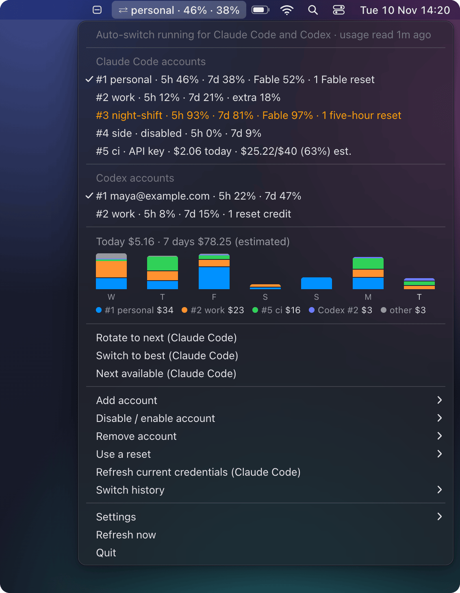
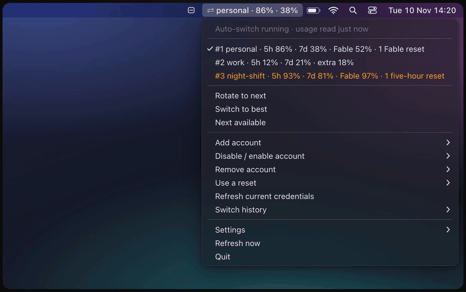
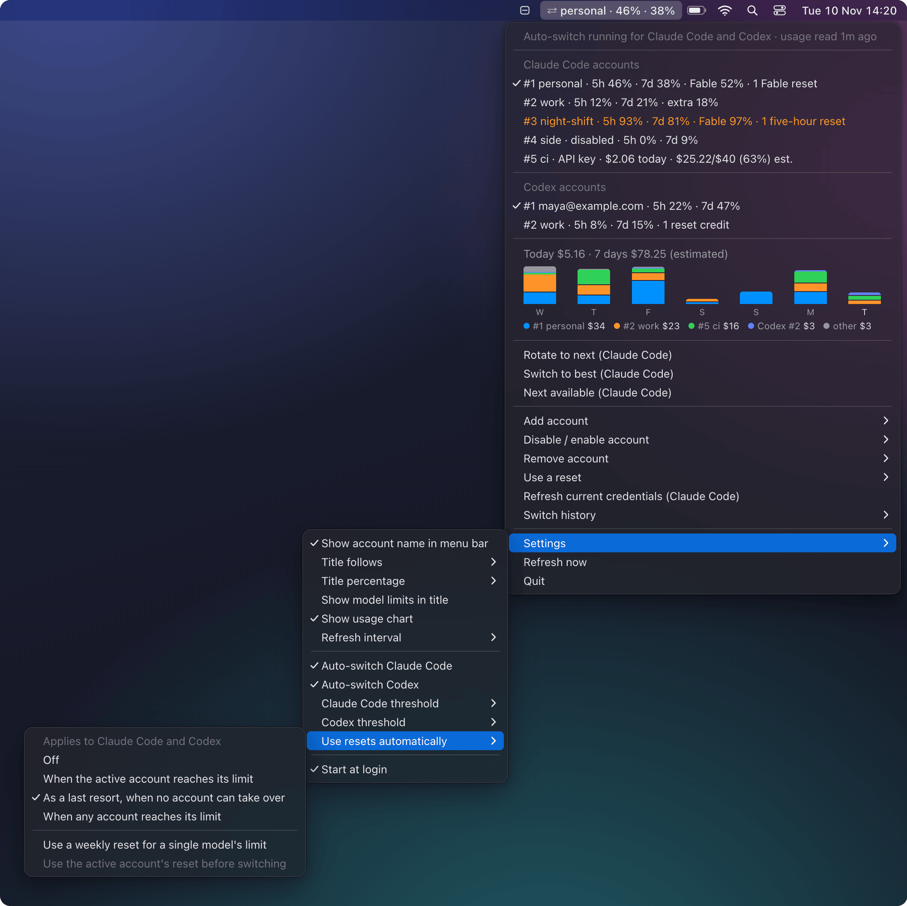
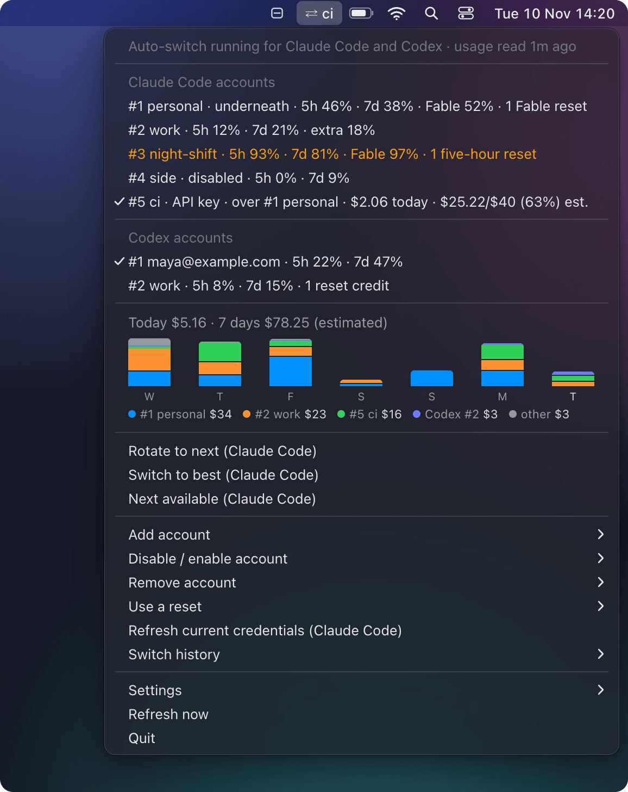
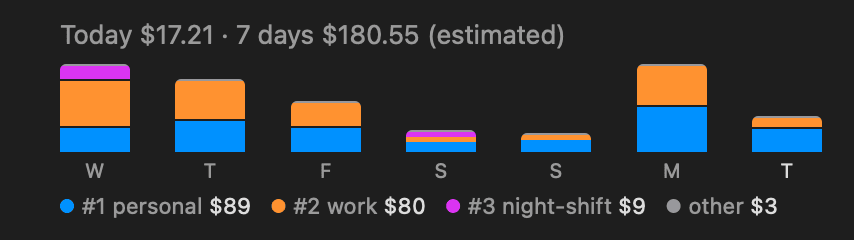
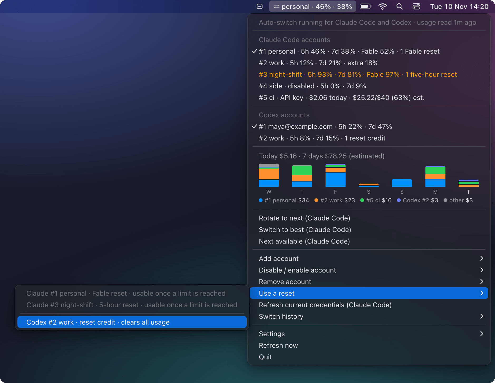
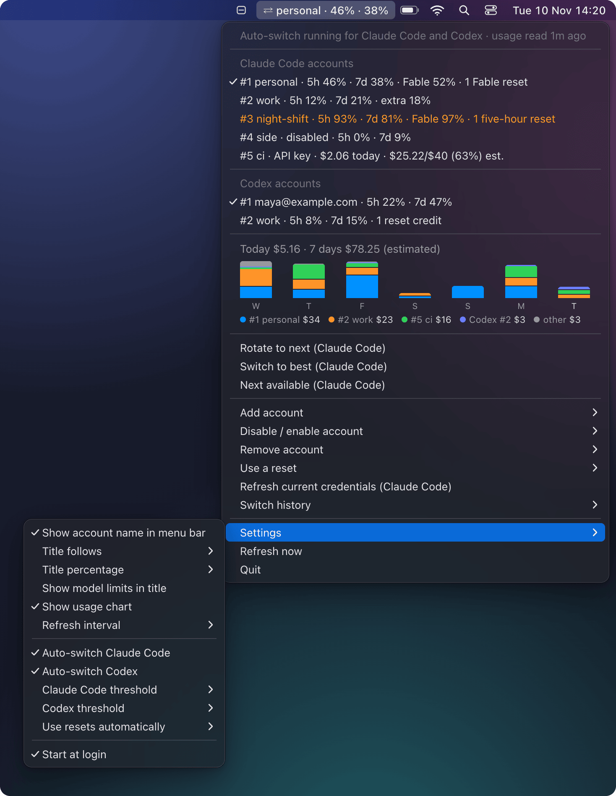

# Menu bar (macOS)

The menu bar app keeps the active account's usage in the macOS menu bar, and its menu lists every Claude Code and Codex account. Click an account to switch to it, or turn on auto-switch and let the app switch for you. This page covers installing it and turning auto-switch on, then walks through the menu from top to bottom, the settings, starting and stopping, notifications and files.

<picture>
  <source media="(prefers-color-scheme: light)" srcset="../assets/screenshots/raw/menubar-light.png">
  
</picture>

The pictures on this page are drawings of the menu, not screenshots of the app: the [demo harness](../scripts/demo/README.md) draws the rows that `menubar.build_menu`, the function the app builds its menu from, returns for made-up accounts, with auto-switch turned on, and places the cost chart's bars with the app's own layout code. The chart on its own, under [The cost row](#the-cost-row), is the app's chart view, drawn off screen. The recording's notification is the text the app posts for that switch.

## Install and start

The menu bar needs the `menubar` extra (it adds `rumps`). Install qswap with it, then start it:

```bash
uv tool install 'ai-quota-swap[menubar]'
# or: pipx install 'ai-quota-swap[menubar]'
qswap menubar
```

`qswap menubar` hands the menu bar to launchd and returns. The first time, it prints `Menu bar started (pid N).`, then says it keeps running after you close the terminal and starts at login, and prints where its plist and log are. From then on launchd starts it at login and restarts it if it crashes. Running `qswap menubar` again prints `Menu bar is already running (pid N).`

Each start also says whether it will switch accounts. Auto-switch is off until you [turn it on](#turn-on-auto-switch), and until then the start warns `auto-switch: off -- the menu bar shows usage but will not switch accounts; turn it on from the menu, or re-run with --auto-switch`.

If qswap is already installed without the extra, `qswap menubar` stops with `The menu bar needs the 'menubar' extra. Install it with: uv tool install --force 'ai-quota-swap[menubar]'` (the pipx form when you installed with pipx).

Keep the install out of `~/Documents`, `~/Desktop` and `~/Downloads`. The uv and pipx defaults already are. See [Limits](#limits).

## Turn on auto-switch

Either of these turns on Claude Code's engine:

- *Settings → Auto-switch Claude Code* in the menu;
- `qswap menubar --auto-switch` in a terminal, which also starts the menu bar, or restarts a running one to apply it (`--no-auto-switch` turns it off).

*Settings → Auto-switch Codex* appears once Codex manages an account. Turning it on asks first, because a Codex switch restarts Codex's background server, which interrupts work in progress.



Each toggle runs the same engine as `qswap auto` or `qswap codex auto` ([auto-switch.md](auto-switch.md)), in a thread of its own. Both use the `autoswitch.*` settings, and Codex uses `codex.threshold` as its switch line. The menu bar's engines switch for real; there is no dry run here.

*Settings → Claude Code threshold* and *Codex threshold* (with Claude Code alone, *Auto-switch threshold*) write the switch line to `settings.json` and restart that engine.

An engine's heartbeat names `qswap menubar`, so `qswap status` and `qswap doctor` can tell it from a `qswap auto` in a terminal.

Turning *Auto-switch Claude Code* off, or quitting the menu bar, while sessions are on an API key the engine entered moves nothing: a notification says that nothing watches the key's limit now, and how to go back. An engine started again carries on with the key.

### Automatic resets



*Settings → Use resets automatically* chooses when the engines spend a usage reset by themselves (`resets.auto`): *Off*, *When the active account reaches its limit* (`active`), *As a last resort, when no account can take over* (`last-resort`, the default) or *When any account reaches its limit* (`on-limit`); hover a choice for `qswap reset`'s line for it. *Use a weekly reset for a single model's limit* is `resets.weeklyForModelLimit`. *Use the active account's reset before switching* is `resets.beforeSwitch` ([resets.md](resets.md#before-switching)); it is greyed, and keeps its check mark, under *Off* and *As a last resort* and while `resets.enabled` is off, where the setting has no effect, and its tooltip says so. All of them apply to Claude Code and Codex, which the submenu's first line says once Codex manages an account. Turning automatic use on from *Off* asks once, since a spent reset cannot be taken back (at most three in 24 hours, per provider); the question is judged on `settings.json` at the click, so a `qswap config set resets.auto off` made since the menu was drawn still asks. The engines read these settings on every check, so a change applies without a restart.

## The menu, top to bottom

The demo harness also prints the menu as an outline, which this page quotes. In it, `✓` is a check mark, `⚠` a row drawn in orange, `▸` a submenu, `(heading)` a section heading, `(greyed)` a row you cannot click and `chart:` the cost row's chart, each day's total and then its legend:

```text
$ uv run python scripts/demo/run.py showcase --menubar --auto-switch
title: ⇄ personal · 46% · 38%
  Auto-switch running for Claude Code and Codex · usage read 1m ago  (greyed)
────
  Claude Code accounts  (heading)
✓ #1 personal · 5h 46% · 7d 38% · Fable 52% · 1 Fable reset
  #2 work · 5h 12% · 7d 21% · extra 18%
  ⚠ #3 night-shift · 5h 93% · 7d 81% · Fable 97% · 1 five-hour reset
  #4 side · disabled · 5h 0% · 7d 9%
  #5 ci · API key · $2.06 today · $25.22/$40 (63%) est.
────
  Codex accounts  (heading)
✓ #1 maya@example.com · 5h 22% · 7d 47%
  #2 work · 5h 8% · 7d 15% · 1 reset credit
────
  Today $5.16 · 7 days $78.25 (estimated)  (greyed)
    chart: Wed $17.03 · Thu $15.85 · Fri $16.91 · Sat $2.27 · Sun $5.67 · Mon $15.35 · Tue $5.16 | #1 personal $34 · #2 work $23 · #5 ci $16 · Codex #2 work $3 · other $3
────
  Rotate to next (Claude Code)
  Switch to best (Claude Code)
  Next available (Claude Code)
────
  Add account ▸
      Add from a setup-token or API key…
      Log in another Codex account…
...
  Refresh now
  Quit
```

### The title

`⇄`, then the active account's alias (or its email up to the `@`), then its 5-hour and weekly percentages: `⇄ personal · 46% · 38%`. *Settings → Title percentage*, *Show model limits in title* (adds `Fable 52%`) and *Show account name in menu bar* change it. With Codex accounts managed, *Settings → Title follows* picks Claude Code's active account, Codex's, or whichever is closest to its limit. `⚠ ⇄` means an auto-switch engine stopped.

### The first row

It says which engines run and how old the active accounts' readings are: `Auto-switch off · usage read 1m ago`, `Auto-switch running for Claude Code and Codex`, `Auto-switch: Claude Code running, Codex off`. A reading older than three refresh intervals (and at least 15 minutes) reads `usage as of 2h 0m ago`. When an engine stopped, the row reads `⚠ Auto-switch stopped, click to restart`; click it to restart, and hover for the reason. With the menu bar's toggle off and a `qswap auto` running in a terminal, it says `running in qswap auto`.

### The accounts

One row per account, with the active account checked. Codex gets its own section once it manages an account. A row is at most 72 characters and uses `qswap list`'s words:

- the account, `#2 work` (or `#1 maya@example.com` without an alias; an account added from a token without an email by its placeholder name, `#5 api-key-5`, never cut mid-word), and `disabled` for one held out of rotation;
- each window as a bare percentage, and `extra 18%` for extra-usage spend. Once a window is at its limit it adds when it comes back: `5h 100% (resets in 1h 12m)`;
- the usage resets held: `1 Fable reset`, `1 five-hour reset`, `1 reset credit` for Codex, and several kinds as one phrase, `resets: 3 Fable, 1 weekly`;
- or a state in place of the figures: `needs re-login`, `usage unavailable (HTTP 503), retrying`, `usage not read yet`, an API-key account's spend (`API key · no usage recorded` while this machine has recorded none, `API key · $0 of $500 this month` with a budget, `API key · $1,150 of $1,187 credit left` with a credit, `API key · spend unknown` when the usage ledger could not be read, `est.` after an estimate, and `limit not enforced` after the figure while a budget or credit has no spend figure from the last 20 minutes, without today's spend; the tooltip says why);
- on the active key, `over #1 personal`, the subscription logged in under it, whose own row says `underneath`, and `by auto-switch` when the engine entered the key. Short of room, the row drops `over #1 personal` first, then today's spend, then `by auto-switch`, then a credit shown after a budget reached (whole, never cut inside its figure), and never the figure or its reason: `✓ #5 ci · API key · by auto-switch · $2.06 today · $25.22/$40 (63%) est.` The tooltip keeps everything;
- `as of 3h 4m ago` after an old reading, and `re-login in 5d 12h` while a saved login nears its expiry.

A row is orange when it needs you: needs re-login, a window at or past the account's switch line, or an API-key account over its budget, with its credit spent or expired, or whose limit is not enforced. Hover a row for its full `qswap list` block.

Click a row to switch that provider to the account. For an account that needs re-login, a *Switch anyway?* dialog first shows the explanation `qswap switch` gives, and its *Switch anyway* button does what `--anyway` does. Switches made anywhere else (`qswap switch`, Claude Code's `/login`, `codex login`) show within about a second.

### With an API key active



A click on an API-key account switches to it at once: running Claude Code sessions follow the key within a few seconds, and the subscription row says `underneath`. The title shows the key's name alone, `⇄ ci`. In the harness, `run.py showcase --menubar --auto-switch -- switch 5` switches to the key and prints the menu; its top part:

```text
title: ⇄ ci
  Auto-switch running for Claude Code and Codex · usage read 1m ago  (greyed)
────
  Claude Code accounts  (heading)
  #1 personal · underneath · 5h 46% · 7d 38% · Fable 52% · 1 Fable reset
  #2 work · 5h 12% · 7d 21% · extra 18%
  ⚠ #3 night-shift · 5h 93% · 7d 81% · Fable 97% · 1 five-hour reset
  #4 side · disabled · 5h 0% · 7d 9%
✓ #5 ci · API key · over #1 personal · $2.06 today · $25.22/$40 (63%) est.
```

Only when qswap cannot add its key line to Claude Code's settings does a *Use the saved key instead?* dialog explain why and what happens to the running sessions; Cancel is the default, and *Switch and log out sessions* (*Switch anyway* from one key to another) does what `--log-out-sessions` does ([api-accounts.md](api-accounts.md#switch-to-an-api-key)). A key line added or removed outside the menu bar (another `qswap switch`, an edit by hand) shows within about a second, like any other switch.

The notes `qswap list` prints about the line get one orange row under the accounts, cut to fit, with the whole sentence and its command in the tooltip:

- a line that names an account with no key, or a line that came back after qswap took it out;
- a key whose line is gone (with the switch that leaves it first);
- another `apiKeyHelper`, another qswap's line, or a variable in the settings' `env` block that outranks the line;
- a settings file that cannot be read while a key is recorded;
- a key auto-switch entered while no engine runs (`Auto-switch entered #5 ci and is not running, so nothing watches its li…`), or only a dry run does (`Auto-switch entered #5 ci and only a dry run is running, so nothing wat…`), or when a `qswap auto --once` last checked it (`Auto-switch entered #5 ci and last checked it 4m ago (qswap auto --once…`);
- while a key auto-switch entered is active, each account holding a reset auto mode keeps, with `qswap reset N` in the tooltip.

### The cost row

`Today $5.16 · 7 days $78.25 (estimated)` totals both providers over today and the last seven days at API list prices, as `qswap usage` does ([usage.md](usage.md)). It appears once the ledger holds anything. Clicking it does nothing. The menu bar reads new session files a minute after it starts and every 15 minutes after that. A `qswap usage` run shows up at the next refresh.

With *Settings → Show usage chart* on, as it is by default, the same sentence sits above a small chart: one column per day for the last seven days, today on the right, each split by account at the estimated cost `qswap usage --by account` gives it. The tallest day fills the chart. One line below names up to four accounts as their rows do, with their seven-day amounts in whole dollars; the rest are `other`, in grey. When the menu shows Codex too, each Codex account's entry starts with `Codex` (`Codex #2 work`) and a Claude Code entry has no provider word, so `#2 work` is Claude Code's. When the line is short of room, names are cut with an ellipsis, down to the number alone (`#2`, `Codex #2`). They are fitted from the largest amount down: each takes its whole name if the line still has room for it, else its longest cut that fits, else its number alone, so a short name can stay whole after a longer one was cut. An account's colour comes from its provider and number, not its rank: Claude Code's #1 is blue, #2 orange, #3 purple, and Codex's #1 green; when two accounts with usage that week would share one, the later takes the next free colour. Turn the setting off for the plain row.

<picture>
  <source media="(prefers-color-scheme: light)" srcset="../assets/screenshots/raw/menubar-chart-light.png">
  
</picture>

### Below the cost row

- *Rotate to next*, *Switch to best*, *Next available*: Claude Code's rotation strategies (`qswap switch`, `--strategy best`, `--strategy next-available`).
- *Add account*: *Add the current Claude Code login (…)* or *Add the current Codex login (…)* when a provider is signed in with a login qswap does not manage; *Add from a setup-token or API key…*, one dialog with the token and an optional email ([api-accounts.md](api-accounts.md)); *Log in another Codex account…*, which shows `qswap codex login` to run in a terminal and copies it if you click *Copy command*.
- *Disable / enable account* and *Remove account*: every account, named with its provider (`Codex #2 work`) when both are managed. A check mark in *Disable / enable account* marks a disabled one. Removing asks what `qswap remove` asks.
- *Use a reset*, while some account holds a usage reset or reset credit ([below](#use-a-reset)).
- *Refresh current credentials*: saves the login Claude Code is signed in with into its account again.
- *Switch history*: the last ten switches, newest first, and *Open full log…*.
- *Settings*: the title, the refresh interval, auto-switch and its lines, automatic resets and *Start at login* ([Settings](#settings)).
- *Refresh now*: read usage again now.
- *Quit*: stop the menu bar until the next login ([Quit, stop or uninstall](#quit-stop-or-uninstall)).

### Use a reset



One row per account and kind, grouped by provider when both have some:

```text
  Use a reset ▸
      Claude #1 personal · Fable reset · usable once a limit is reached  (greyed)
      Claude #3 night-shift · 5-hour reset · usable once a limit is reached  (greyed)
    ────
      Codex #2 work · reset credit · clears all usage
```

A row that can be used says what it clears (`#1 personal · Fable reset · clears Fable usage only`). A row that cannot be used now is greyed and says why, as `qswap reset` does (`usable once a limit is reached`); one qswap cannot name is greyed. A row is at most 72 characters: the account's name gives way first, then what the reset clears (the tooltip has the whole row).

Clicking a row runs what `qswap reset N --grant ID` runs, in the background: it reads the account again, then asks, Cancel being the default, with what `qswap reset` prints before it asks (the trade when a broad reset would meet a narrow limit, `Usage as of 12m ago; it could not be refreshed` when the reading is old, and that a used reset cannot be undone). *Use reset* then claims it with a retry-safe request id, reserved like the engine's own claims, so it is refused while another claim on that account is in flight (`A reset on #1 personal is already being used; try again in a moment.`). If anything was recorded for the account after the reading the dialog showed (the engine used a reset meanwhile), nothing is sent. The account's rows read `in progress` until a notification says how it went; a failure once the request was sent reads `… may have been used: why. Run qswap reset to see where things stand.`, never `Did not use`.

When the engines spend resets by themselves is *Settings → Use resets automatically* ([below](#automatic-resets)).

### With nothing managed

The accounts section says `No accounts are managed yet.` and the next step for each login on this machine (`Claude Code is logged in as maya@example.com. Add it with: qswap add`). Click a line that names a login to add it; *Add account* offers the same logins.

## Settings

*Settings* in the menu holds, from the top: *Show account name in menu bar*, *Title follows* (with Codex managed), *Title percentage*, *Show model limits in title*, *Show usage chart* and *Refresh interval*; then the auto-switch toggles, their thresholds and *Use resets automatically*; then *Start at login*.



The menu's own preferences live in `menubar_settings.json` in the data directory (`~/.ai-quota-swap` on macOS). Change them from the menu; the menu bar reads the file when it starts.

| Setting | Default | Meaning |
|---|---|---|
| `show_account_name` | `true` | the account's name in the title |
| `title_pct` | `"both"` | percentages in the title: `off`, `5h`, `7d` or `both` |
| `title_scoped` | `false` | add per-model limits (`Fable 52%`) to the title |
| `refresh_interval` | `60` | seconds between reads: `30`, `60` or `300` |
| `auto_switch_enabled` | `false` | *Auto-switch Claude Code* |
| `codex_auto_switch_enabled` | `false` | *Auto-switch Codex* |
| `title_follows` | `"claude"` | whose active account the title shows: `claude`, `codex` or `closest` |
| `usage_chart` | `true` | *Show usage chart*: the cost row as a seven-day chart by account |

A file from an earlier build loads as it did, and a key this build does not know is kept. The switch lines are qswap settings, shared with the command line ([settings.md](settings.md)):

| Setting | Default | Meaning |
|---|---|---|
| `autoswitch.threshold` | `90` | Claude Code's switch line; the menu offers 80, 90, 95 and 98 |
| `codex.threshold` | `99` | Codex's switch line; the menu offers 90, 95, 98 and 99 |
| `resets.auto` | `last-resort` | *Use resets automatically*: `off`, `active`, `last-resort` or `on-limit` |
| `resets.weeklyForModelLimit` | `false` | *Use a weekly reset for a single model's limit* |
| `resets.beforeSwitch` | `false` | *Use the active account's reset before switching* (greyed under `off` and `last-resort`, and with `resets.enabled` false) |

`qswap config set autoswitch.threshold 95` changes it too, but a running engine picks the change up only when it restarts. Use the menu's threshold submenu, or turn the toggle off and on. A `resets.*` or `autoswitch.includeApiKeyAccounts` change made with `qswap config set` applies at the engines' next check and shows in the menu at its next refresh.

## Quit, stop or uninstall

*Quit* in the menu stops it until the next login. *Settings → Start at login* turns the start at login off, after which `qswap menubar` starts it for the current session only.

| Command | Does |
|---|---|
| `qswap menubar` | start it; the first time, also set it to start at login |
| `qswap menubar --auto-switch` | turn Claude Code's auto-switch on and start the menu bar, restarting a running one to apply it (`--no-auto-switch` turns it off) |
| `qswap menubar --service-status` | whether it is installed and running (with its pid), whether it starts at login, which build it runs and which auto-switch toggles are on |
| `qswap menubar --install-service` | register the start at login again and restart it now |
| `qswap menubar --uninstall-service` | stop it and remove its LaunchAgent and wrapper app |
| `qswap menubar --foreground` | run it attached to this terminal, for debugging; refused while the service runs |

To uninstall the menu bar and keep the command line, run `qswap menubar --uninstall-service`. `qswap purge` removes the menu bar's LaunchAgent, wrapper app and logs along with the rest of qswap's data ([SECURITY.md](../SECURITY.md#remove-everything)).

`qswap upgrade` restarts a running menu bar when the build changed. After an upgrade made another way, the next `qswap menubar` restarts it onto the new build, and `--service-status` warns until then.

## Notifications

Every notification is titled `ai-quota-swap`. With both providers managed, the account is named with its provider (`Claude #1 personal`).

| Event | Example | How often |
|---|---|---|
| An engine switched | `Switched #1 personal → #2 work · 5h reached 91%`; onto a key while a reset auto mode keeps is usable: `Switched #1 personal → #5 ci · 7d limit reached; #1 personal holds 1 weekly reset auto mode keeps (its 7d window refills in 9h); to spend it instead: qswap reset 1` | every switch |
| You switched from the menu | `Switched #1 personal → #2 work. Claude Code picks up the new account within 30 seconds; restart it to apply now.` To an API-key account: `Switched #1 personal → #5 ci. Running Claude Code sessions move to the key within a few seconds. #1 personal stays logged in underneath. claude.ai connectors and Remote Control are unavailable while a key is in use. Go back with: qswap switch 1` | every switch |
| An engine did not move to an API key | `Not switching to #5 ci: qswap cannot add its key line to Claude Code's settings; see why with: qswap doctor`, `Not switching to an API key: #5 ci has no budget or credit; set one with: qswap budget 5 AMOUNT`, `Not switching to #5 ci: its spend could not be measured for 20 minutes; check it with: qswap usage`, `Not switching to an API key yet: #3 night-shift's usage could not be read this check; waiting up to 5m for it` | once, until the engine switches or decides otherwise |
| An engine cannot leave a key at its limit | `Staying on #5 ci past its monthly budget: no login is under the key to go back to. Leave it with: qswap switch 1` | once, until the engine switches or decides otherwise |
| An engine cannot read the settings that hold the key line | `~/.claude/settings.json cannot be read (...); qswap last made #5 ci the active API key there, and its key line may still be in it. Fix the JSON in ~/.claude/settings.json, then retry.` | once, until the engine switches or decides otherwise |
| An engine stopped while sessions are on a key it entered | `Sessions stay on #5 ci, which auto-switch entered; nothing watches its limit now. To go back: qswap switch 1` | every time |
| A usage reset was used | `Used a Fable reset on #1 personal · Fable reached 100%, 3d before it resets on its own · 0 left on this grant` | every reset |
| A reset was not used | `Did not use a Fable reset on #1 personal: refused` | once per account and result |
| You used a reset from the menu | `Used a Fable reset on #1 personal · Fable refilled · 2 left on this grant`; `A Fable reset on #1 personal was already used: an earlier attempt went through. Run qswap reset to see where things stand.` (a retry the server had already counted); `A Fable reset on #1 personal may have been used: why. Run qswap reset to see where things stand.`; `Usage on #1 personal changed while this was open; nothing was used. Open the menu again.`; or `Did not use …: why` | every use |
| An account needs re-login | `#4 side needs re-login: its saved login was refused. Log in to it in Claude Code (/login), then run: qswap add` | once per account and reason |
| Every account is at its limit | `All accounts are at their limit; the first resets 15:32 · in 1h 12m` | once per provider until the next switch or reset time |
| An API-key budget nears | `#5 ci has spent $410.00 of its $500.00 monthly budget (82%)` | once per account and month |
| A setting matches nothing | `Warning: autoswitch.model 'Fabel' matches no limit any account reports` | once, whichever engine noticed |
| An engine's check failed | `Auto-switch error: network unreachable. It retries by itself.` | once per message an hour |
| An engine stopped | `Auto-switch stopped: the engine loop ended on its own. Open the menu to restart it.` | every time |
| An engine did not start | `Codex auto-switch did not start: No Codex accounts are managed yet.` | every attempt |

A failed action (a switch, an add, a remove) shows the command line's error in an alert.

## Files

| File | What |
|---|---|
| `~/Library/LaunchAgents/com.aiquotaswap.menubar.plist` | the LaunchAgent while Start at login is on; in the data directory while it is off |
| `~/Library/Logs/com.aiquotaswap.menubar.log`, `.err` | the service's output |
| `~/.ai-quota-swap/ai-quota-swap.log` | the switch log that *Switch history* reads |
| `/Applications/AI Quota Swap Menubar.app` | the wrapper app, rebuilt on every start |

The wrapper app gives the process the bundle identifier `com.ai-quota-swap.menubar`, which menu bar managers (Dimble, Ice, Bartender, SaneBar) need to list, hide and order the icon. `AI_QUOTA_SWAP_NO_BUNDLE=1 qswap menubar --foreground` runs without it; the service does not pass that variable on. The service does take the `CLAUDE_CONFIG_DIR`, `CLAUDE_SECURESTORAGE_CONFIG_DIR`, `XDG_DATA_HOME`, proxy and certificate variables (`HTTPS_PROXY`, `SSL_CERT_FILE` and the like) of the shell that set it up, and `--install-service` from a shell with other values says what changed.

## How it is built

`menubar.build_menu` turns both providers' state and the settings into the whole menu, and a thin `rumps` layer draws it and maps each row to a handler. The design is in [architecture.md](architecture.md).

## Limits

- Codex account switching has been tested against fakes and with one real account, not yet with two real Codex accounts ([codex.md](codex.md)).
- macOS only. Elsewhere `qswap menubar` prints `The menu bar is only available on macOS.` and exits 1. `qswap auto` switches accounts on every platform.
- Install location: macOS privacy rules keep launchd agents out of `~/Documents`, `~/Desktop` and `~/Downloads`, so the service cannot start when qswap runs from there (an editable install from a checkout in `~/Documents`, for example). `qswap menubar` does not notice. `qswap doctor` reports it as `qswap runs from ~/Documents/…; macOS keeps background services out of ~/Documents`. Reinstall outside those folders with `uv tool install --force 'ai-quota-swap[menubar]'`, then run `qswap menubar` ([troubleshooting.md](troubleshooting.md)).
- On macOS 26, a framework build of Python (Homebrew's, python.org's) has been seen not to draw the icon: the process runs and logs nothing. `qswap menubar` warns about it. With uv, reinstall on uv's own Python: `uv tool install --managed-python --force 'ai-quota-swap[menubar]'`.
- If you switched it off under System Settings → General → Login Items & Extensions → Allow in the Background, `qswap menubar` still starts it when you ask, but macOS will not start it at login.
- When `/Applications` is not writable, the wrapper app goes in the data directory, and a menu bar manager that hides anything hides this icon too.
