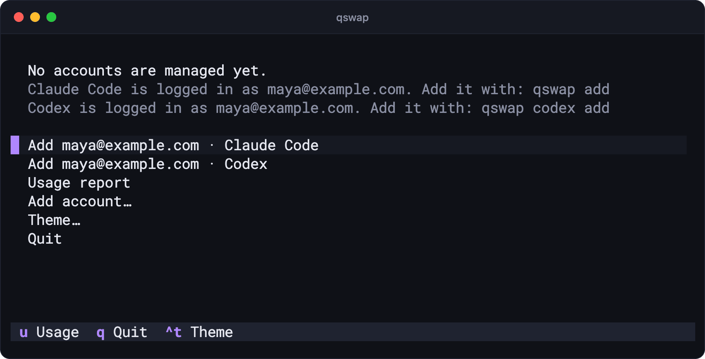
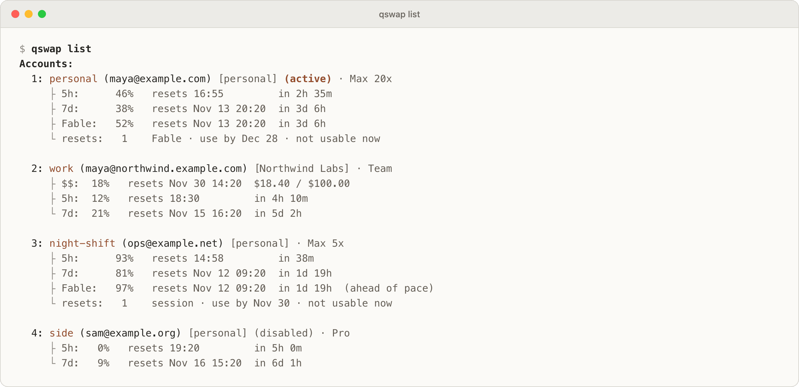
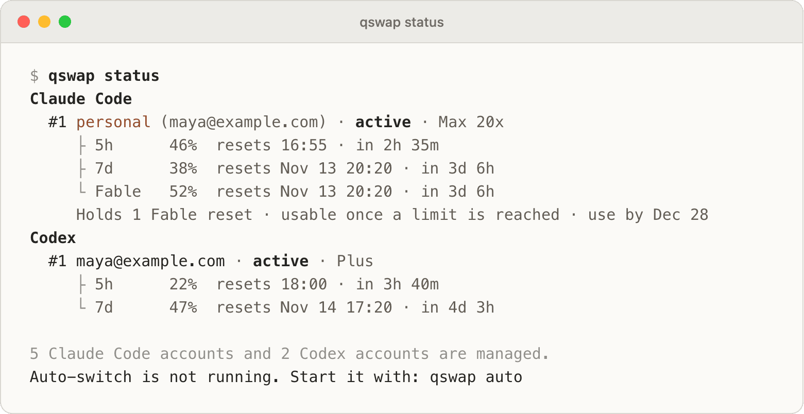
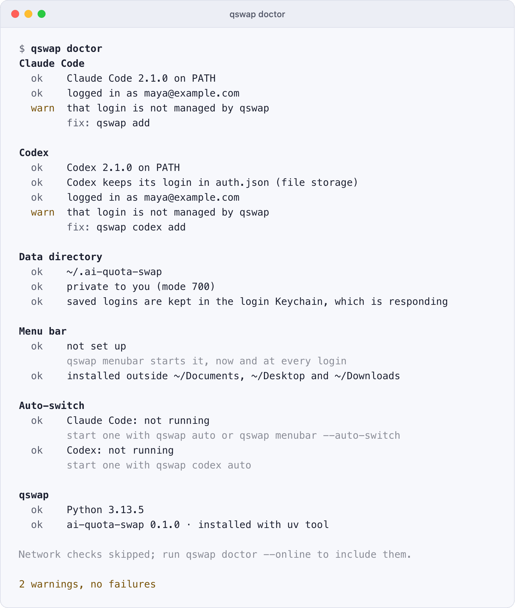

# Quick start

After this page you will have qswap installed, two accounts saved, their usage on screen, and a switch behind you. It takes about five minutes and two logins.

## 1. Install

ai-quota-swap is not on PyPI yet, so install it from the repository with uv or pipx:

```bash
uv tool install git+https://github.com/seangeng/ai-quota-swap
# or
pipx install git+https://github.com/seangeng/ai-quota-swap
```

It needs Python 3.12 or newer and runs on macOS, Linux (WSL included) and Windows. Check that it is on your PATH:

```text
$ qswap --version
qswap 0.1.0
```

For the macOS menu bar app, install the `menubar` extra instead; [menubar.md](menubar.md) has the command.

## 2. Save your first account

Log in to Claude Code as usual. qswap sees that login but does not manage it yet:

```text
$ qswap list
No accounts are managed yet.
Claude Code is logged in as maya@example.com. Add it with: qswap add
```

Save it. An alias is optional; it gives the account a short name you can use anywhere a number or email works:

```text
$ qswap add --alias personal
Added #1 personal (maya@example.com)
To add another account, log in to it in Claude Code (/login), then: qswap add
```

Bare `qswap` in a terminal opens the dashboard, which offers the same step on a first run:



## 3. Add your second account

In Claude Code, run `/login` and sign in with the other account. Go straight to `/login`: a `/logout` first may revoke the saved login of the account you leave. Then save the new login:

```bash
qswap add --alias work
```

Repeat for every account you have. Running `qswap add` for an account that is already saved refreshes its saved login instead of adding it twice.

If you use Codex, save its login the same way, and add further Codex accounts with `qswap codex login`, which leaves the login you are on signed in:

```text
$ qswap codex add
Added #1 maya@example.com
To add another account without signing this one out, run: qswap codex login
```

Codex support is experimental; read [codex.md](codex.md) before your first Codex switch.

## 4. See every account's usage

<picture>
  <source media="(prefers-color-scheme: dark)" srcset="../assets/screenshots/raw/list.png">
  
</picture>

Each account shows its plan and its windows: `5h` (the 5-hour window), `7d` (the weekly window) and per-model weekly windows such as `Fable`, each with when it refills. A figure turns yellow at the account's switch line and red at its limit. `Holds 1 Fable reset` means the account has a usage reset banked ([resets.md](resets.md)). `qswap status` shows only the active account of each provider, and whether auto-switch is running:

<picture>
  <source media="(prefers-color-scheme: dark)" srcset="../assets/screenshots/raw/status.png">
  
</picture>

## 5. Switch

Name the account by number, email or alias:

```text
$ qswap switch work
Switched #1 personal → #2 work (maya@northwind.example.com)
...
Claude Code picks up the new account within 30 seconds; restart it to apply now.
```

You do not have to restart Claude Code. On macOS it reads the login from the Keychain and picks up the new one within about 30 seconds; on Linux and Windows it reads a file and uses the new account from its next message. The first message on the new account may cost extra usage while its conversation cache is rebuilt.

This is true for subscription accounts. A running session cannot move to an API-key account: while sessions are running, `qswap switch` refuses one and says why ([api-accounts.md](api-accounts.md#switch-to-an-api-key)).

`qswap switch` with no account moves to the next one, and `qswap switch --strategy best` to the one with the most quota left. Both skip accounts you disabled and accounts that need re-login, and API-key accounts while Claude Code sessions are running.

## 6. Let qswap switch for you

Try it without changing anything first:

```bash
qswap auto --dry-run
```

Then run it for real. It checks every minute, switches when the active account reaches 90%, and runs until you press Ctrl-C:

```bash
qswap auto
```

The dashboard's auto view (`qswap`, then `g`) and the macOS menu bar run the same engine. [auto-switch.md](auto-switch.md) covers the strategies, the lines and running it unattended.

## When something looks wrong

Run `qswap doctor`. It checks Claude Code, Codex, the data directory, the menu bar and auto-switch, changes nothing, and prints the command that fixes each problem:

<picture>
  <source media="(prefers-color-scheme: dark)" srcset="../assets/screenshots/raw/doctor.png">
  
</picture>

[troubleshooting.md](troubleshooting.md) lists the problems people hit and their fixes.

## Settings worth knowing

| Setting | Default | Meaning |
|---|---|---|
| `autoswitch.threshold` | `90` | The percent used at which auto-switch moves off the active account: `qswap config set autoswitch.threshold 85`. |
| `ui.theme` | `auto` | Colours of the dashboard and of command output: `dark`, `light`, or `auto` to follow the terminal. |
| `updates.check` | `true` | Look up the newest release once a day and print a hint: `qswap config set updates.check false` turns it off. |

`qswap config` lists every setting; [settings.md](settings.md) explains each.

## Before you rely on it

- Do not run qswap and claude-swap against the same accounts: each refreshes the logins it saved, and the other is left holding logins that no longer work. To move across, see [coming-from-claude-swap.md](coming-from-claude-swap.md).
- An `ANTHROPIC_API_KEY`, `ANTHROPIC_AUTH_TOKEN` or `CLAUDE_CODE_OAUTH_TOKEN` exported in your shell makes Claude Code use that instead of the account login, so a switch does not reach it. Unset it in shells where you want qswap's accounts.
- qswap reads usage through endpoints Anthropic and OpenAI do not document. [SECURITY.md](../SECURITY.md) says what it stores and what it sends where.
