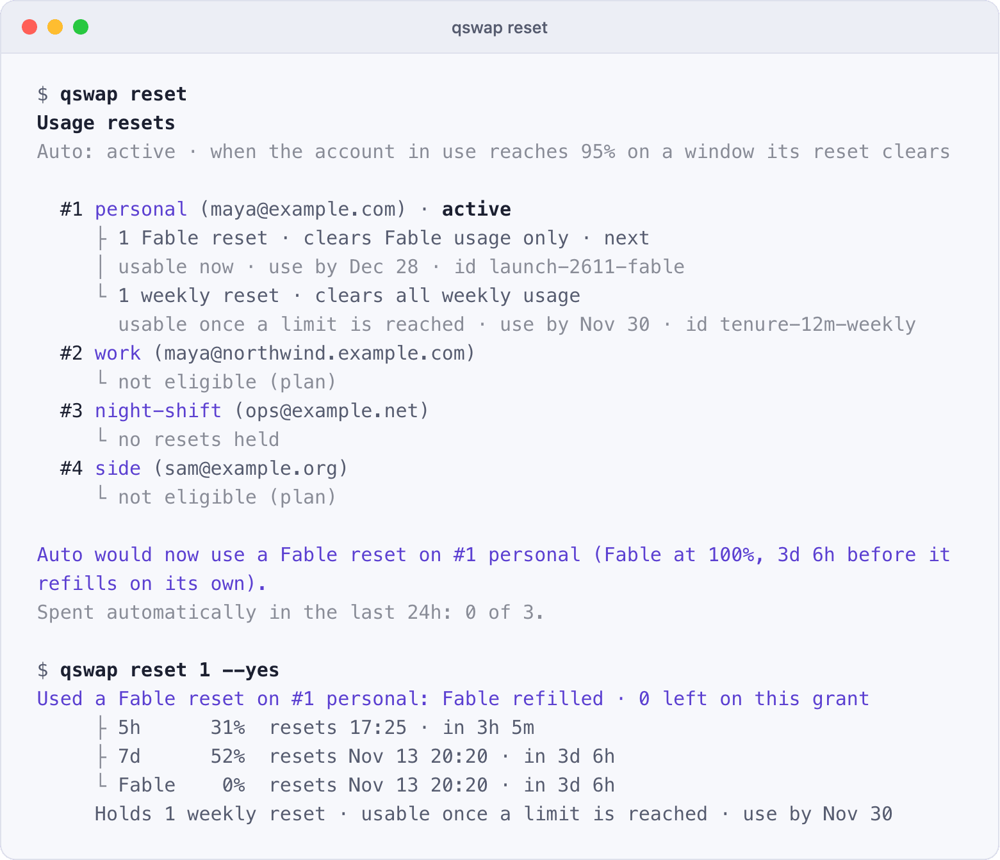
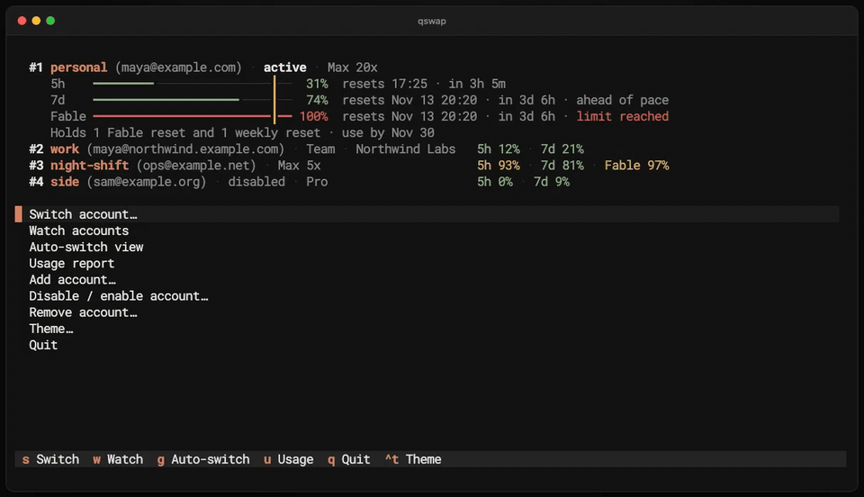

# Usage resets

qswap reads the usage resets each account holds, spends one when you ask, and can spend them for you at the right moment. After this page you will know what each kind of reset clears, when auto mode spends one, and how to spend or keep one yourself.

<picture>
  <source media="(prefers-color-scheme: dark)" srcset="../assets/screenshots/raw/reset.png">
  
</picture>

## What a usage reset is

Anthropic grants eligible plans banked usage resets (Claude Code's `/limit-reset`). Each one refills the windows it clears to 0% when you spend it; the weekly reset day stays where it was. A reset has a "use by" date and is lost if you do not spend it by then.

Codex accounts can hold reset credits (Codex's `/usage`, "Redeem reset"). qswap lists and spends them with `qswap codex reset`, under the same rules, and calls each one "1 reset credit".

## See what you hold

`qswap reset` lists every account's resets, says what auto mode would spend right now, and counts the automatic spends of the last 24 hours:

```
$ qswap reset
Usage resets
Auto: active · when the account in use reaches 95% on a window its reset clears

  #1 personal (maya@example.com) · active
     ├ 1 Fable reset · clears Fable usage only · next
     │ usable now · use by Dec 28 · id launch-2611-fable
     └ 1 weekly reset · clears all weekly usage
       usable once a limit is reached · use by Nov 30 · id tenure-12m-weekly
  #2 work (maya@northwind.example.com)
     └ not eligible (plan)
  #3 night-shift (ops@example.net)
     └ no resets held
  #4 side (sam@example.org)
     └ not eligible (plan)

Auto would now use a Fable reset on #1 personal (Fable at 100%, 3d 6h before it
refills on its own).
Spent automatically in the last 24h: 0 of 3.
```

Each reset shows its kind, what it clears, whether it can be spent now, its use-by date and its id. `next` marks the one the server names as next (for Codex, the usable credit that expires first). A reset marked `usable once a limit is reached` cannot be spent, by hand or automatically, until the server reports it usable.

Other views show the same holding in fewer words:

- `qswap list` and the dashboard print a line under the account: `Holds 1 Fable reset and 1 weekly reset · use by Nov 30`.
- The menu bar ends the account's row with the count, `1 Fable reset`, or `2 Fable · 1 weekly resets` once kinds differ.

`qswap reset --json` gives the same data for scripts; see [json-output.md](json-output.md).

## Kinds

Resets are not interchangeable. A Fable reset does not clear the all-models weekly window, and a weekly reset spent on a Fable limit uses up a reset worth more. qswap reads each reset's kind from the windows it clears:

| Kind | Clears | Auto mode spends it for |
|---|---|---|
| Fable reset (or another model's) | that model's weekly window; when the server marks it so, it also gives back what that model used of the all-models weekly window | that model's window |
| five-hour reset | the 5-hour window | the 5-hour window |
| weekly reset | the all-models weekly window (`7d`), and any per-model window it also lists | the all-models weekly window; its per-model windows only with `resets.weeklyForModelLimit` |
| full reset | the 5-hour and the all-models weekly windows | either of them |

Every Codex credit is a full reset. On a plan that reports only a weekly window, a credit clears that window alone and works as a weekly reset.

A Fable reset is never spent for the all-models weekly window, even though it gives some of it back. A weekly or full reset is never spent automatically when only a per-model window is at its line; `qswap config set resets.weeklyForModelLimit true` allows it. When that rule is the only thing keeping a reset back, `qswap reset` says so in one line under its plan.

When more than one reset would help, auto mode spends the narrowest: a Fable or five-hour reset before a weekly one, a weekly one before a full one, whatever order they are listed in and whichever expires first. The active account's resets come before other accounts'.

A reset whose shape qswap does not recognize is listed as `1 other reset` with the windows it names. A reset that also lists a window qswap does not know keeps its kind and adds "(also lists ...)". Neither is ever spent automatically; `qswap reset N --grant ID` can still spend them.

## When auto mode spends one

Every auto-switch engine can spend resets: `qswap auto`, `qswap codex auto`, the dashboard's auto view once you take it out of dry run, and the menu bar's auto-switch. The engine spends at most one per check, before it decides whether to switch, so a refill counts in the same check: an active account brought back under its line stays, a refilled account becomes somewhere to switch to. Rules for switching are in [auto-switch.md](auto-switch.md).

`resets.auto` decides when:

- `last-resort` (default): only when the active account has reached `resets.threshold` (95%) on a window one of its resets is for, and switching cannot relieve it. That means no other account is below its switch lines, or the engine does not watch that window at all (a Fable limit when `autoswitch.model` does not name Fable). When the active account holds no reset that helps, qswap refills another account that the engine can then switch to.
- `active`: spends the active account's own reset as soon as a window it is for reaches `resets.threshold`, even when another account has room. Which comes first, the reset or the switch, depends on where `resets.threshold` sits against the switch line ([auto-switch.md](auto-switch.md#switch-lines)). At or below the line, the reset comes first, since the engine spends before it decides whether to switch; to spend the reset before moving with a switch line of 98: `qswap config set resets.threshold 98`. Above the line (the default 95 against a line of 90, or `qswap config set resets.threshold 100` to spend only at the limit), auto-switch moves at the line to another account with room, and the reset stays banked. It is spent when the active account reaches `resets.threshold` anyway: when there is nowhere to move, or when its usage passes the line between two checks.
- `on-limit`: spends on any account in rotation whose window reaches `resets.threshold`, the active account first.
- `off`: never spends automatically. `qswap reset N` still works.

Here the dashboard's auto view goes live, and the engine spends the narrowest reset that helps:



A dry run says what it would spend and ends the check there, without also reporting a switch the refill would make unnecessary:

```
$ qswap auto --once --dry-run
14:20:00  Would use a Fable reset on #1 personal · Fable reached 100%, 3d before
          it resets on its own (dry run)
14:20:00  #1 personal at Fable 100% (limit reached)
            #2 work         5h 12% · 7d 21%
            #3 night-shift  5h 93% · 7d 81% · Fable 97% · over its switch line
            #4 side         disabled
```

## Guards

Spending a reset cannot be undone, so every automatic spend passes these checks.

- **Worth it.** A reset is kept when its window refills on its own within `resets.minHoursLeft` (24 hours). It is also kept when another window would still sit at or over `resets.threshold` afterwards: a Fable reset does nothing for an account whose all-models weekly window stays at 98%, and a weekly reset does nothing for one whose Fable window, if the reset does not list it, stays at 100%. A Fable reset that gives back Fable's share of the weekly window is credited with that share when the server reports it. A reset on the active account is kept when the engine would still switch away from it afterwards, to an account with room.
- **Not lost to expiry.** Every mode except `off` also spends a reset that is about to expire. A reset counts as expiring once its date is within `resets.expiryDays` (7) days for each unused reset that expires on or before it: one reset alone 7 days out, three expiring together 21 days out, so they can be spent a window apart. Inside that runway the line drops to `resets.expiryThreshold` (50%), measured on the window the reset is for: the all-models weekly window for a weekly reset, the model's window for a Fable reset. The worth-it checks still apply. Among expiring resets the active account's go first, then the one closest to its deadline, whatever its kind. `resets.expiryDays 0` turns this off.
- **A fresh reading first.** Before it spends, the engine reads the account again and plans again on the new numbers. Without a reading from the last two minutes it spends nothing. It reserves the claim in its state file under a lock, so two engines (the menu bar and a cron `qswap auto --once`, say) cannot both spend.
- **Never twice on old numbers.** After a claim, the account is held out until a reading taken after the claim arrives: at least 30 minutes after a reset, 60 after a refusal, 10 after any other answer or none.
- **A retry cannot spend twice.** Each claim carries a request id that qswap stores before it sends anything. When no answer arrives, the next attempt on the same reset, automatic or by hand, sends the same id, and the server cannot spend a second reset for it.
- **A daily cap.** Automatic spending stops after 3 claims in 24 hours, per provider, across all of that provider's accounts. A claim whose outcome is unknown counts as spent. Resets you spend with `qswap reset N` do not count.
- **Only accounts in rotation.** Never a disabled account, one that needs re-login, or an API-key account.
- **`--dry-run` only reports.** `qswap auto --dry-run` never spends.

## Spend one by hand

```bash
qswap reset 2                    # spend one on #2 (asks first)
qswap reset 2 --grant ID         # spend that reset (ids are in qswap reset)
qswap reset 2 --yes              # do not ask
```

`qswap reset N` can spend any kind. Without `--grant` it picks a usable reset that clears a window at or over `resets.threshold`, narrowest first, then the server's next pick, then the one expiring soonest. Before it asks, it describes the reset: what it clears, the windows it refills, what is left on the grant after, and that a used reset cannot be undone. When you are about to spend a weekly or full reset while only a per-model window is at its line, it also says what you give up: that the reset clears all weekly usage (all usage, for a full reset) while only Fable is at its limit, with your 5h and 7d figures.

Without a terminal to ask on it stops and names the flag:

```
$ qswap reset 1
Error: qswap reset needs --yes when there is no terminal to ask on
```

With `--yes`:

```
$ qswap reset 1 --yes
Used a Fable reset on #1 personal: Fable refilled · 0 left on this grant
     ├ 5h      31%  resets 17:25 · in 3h 5m
     ├ 7d      52%  resets Nov 13 20:20 · in 3d 6h
     └ Fable    0%  resets Nov 13 20:20 · in 3d 6h
     Holds 1 weekly reset · usable once a limit is reached · use by Nov 30
```

The weekly window dropped from 74% to 52% because this Fable reset also gives back Fable's share of it. If you press Ctrl-C while a claim is in flight, qswap says the reset may have been used and that `qswap reset` shows where things stand; a retry reuses the request id.

## Codex reset credits

```
$ qswap codex reset
Reset credits
Auto: last-resort · when the active account reaches 95% and no switch helps

  #1 maya@example.com · active
     └ no reset credits reported
  #2 work (maya@northwind.example.com)
     └ 1 reset credit · clears all usage · next
       usable now · use by Nov 22 · id rlrc_demo_2611_northwind

Auto would not use a reset credit right now.
Spent automatically in the last 24h: 0 of 3.
```

`qswap codex reset N`, `--grant ID` and `--yes` work as above; without `--grant` it spends the credit that expires first. `qswap codex auto` spends credits under the same `resets.*` settings, only for the 5-hour or weekly window, and keeps its own daily count. Whether a credit also resets a Codex limit beyond those two is not known, so auto mode never spends one for such a limit. A credit on a saved login whose access token has expired cannot be spent until Codex renews that login. More in [codex.md](codex.md#reset-credits).

## Turn resets off

```bash
qswap config set resets.enabled false
```

qswap then stops reading reset status, `qswap reset` refuses with the command that turns it back on, and nothing is spent automatically. For Codex, the credit list is no longer read.

Reading reset status identifies as Claude Code. Anthropic's server reports resets only to Claude Code, so the usage request that carries them sends Claude Code's client agent string (`claude-cli/<version> (external, cli)`, with the version of the Claude Code you have installed), and so does a claim. Anthropic sees those requests as coming from Claude Code. With `resets.enabled false` the usage request goes out under qswap's own agent string. Codex requests always use qswap's own. See [../SECURITY.md](../SECURITY.md).

## Settings

| Setting | Default | Meaning |
|---|---|---|
| `resets.enabled` | `true` | Read each account's resets with its usage. `false` stops reading them and stops all spending. |
| `resets.auto` | `last-resort` | When auto mode spends a reset: `last-resort`, `active`, `on-limit` or `off` (see [above](#when-auto-mode-spends-one)). |
| `resets.threshold` | `95` | How full a window must be, in percent (50 to 100), before auto mode spends a reset for it. `qswap reset N` uses it to pick a reset. |
| `resets.minHoursLeft` | `24` | Keep a reset when its window refills on its own within this many hours (0 to 168). |
| `resets.expiryDays` | `7` | Days of runway per unused reset before its use-by date (0 to 60; 0 turns the expiry rule off). |
| `resets.expiryThreshold` | `50` | Inside that runway, spend once the reset's window reaches this percent (0 to 100). |
| `resets.weeklyForModelLimit` | `false` | Let auto mode spend a weekly or full reset when only a per-model limit is reached. |

Change one with `qswap config set resets.auto off`. Every setting is in [settings.md](settings.md).

## Limits and caveats

- A spent reset cannot be undone.
- Spending a Codex credit has only been tested against a fake server. No real credit has been spent with qswap yet. Which windows one credit resets on a plan with both a 5-hour and a weekly window is not confirmed; qswap assumes both.
- The endpoints for reading and spending resets are the ones the official clients use. Neither Anthropic nor OpenAI documents them, and they can change without notice.
