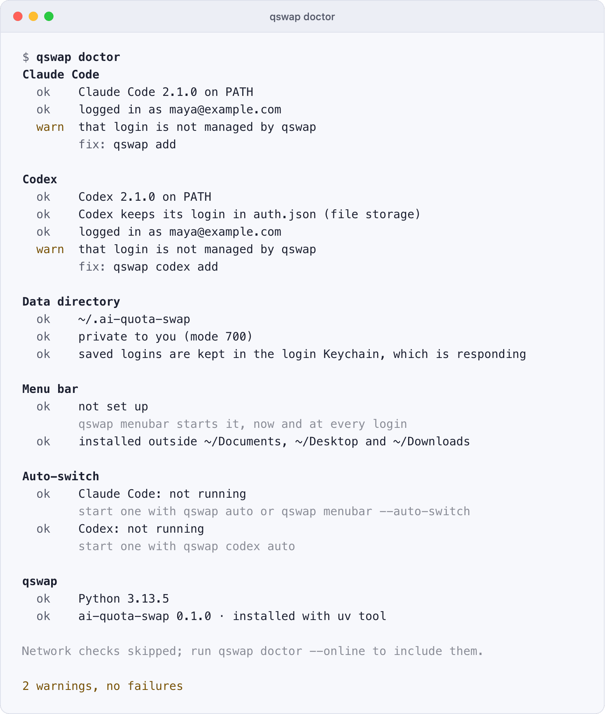

# Troubleshooting

Run `qswap doctor` to find what is wrong, then look up the symptom below. Each section shows the message qswap prints and the commands that fix it.

## Start with qswap doctor

`qswap doctor` checks your setup in groups and prints one line per check, marked `ok`, `warn` or `fail`. A check that does not pass has the command that fixes it on the next line.

- **Claude Code**: `claude` is on your PATH, who is logged in, and whether qswap manages that login.
- **Codex**, when Codex is installed or has a login: the same, plus whether Codex keeps its login in `auth.json`, the only storage qswap supports.
- **Data directory**: where it is, that only you can open it (mode 700; not checked on Windows), and where saved logins are kept. On macOS it asks the login Keychain for an item that does not exist, which decrypts nothing.
- **Menu bar** (macOS): whether it is set up and running, and whether qswap is installed outside `~/Documents`, `~/Desktop` and `~/Downloads`.
- **Auto-switch**: whether an engine is running for each provider.
- **qswap**: the Python version and how qswap was installed.

<picture>
  <source media="(prefers-color-scheme: dark)" srcset="../assets/screenshots/raw/doctor.png">
  
</picture>

When qswap manages Codex accounts but the `codex` command is missing, the Codex group warns and names the install command (with no Codex accounts and no Codex login, it skips the group instead):

```
$ qswap doctor
...
Codex
  warn  Codex was not found (codex is not on PATH)
        fix: npm install -g @openai/codex
  ok    Codex keeps its login in auth.json (file storage)
  ok    logged in as maya@example.com
  ok    managed by qswap as #1 maya@example.com
...
1 warning, no failures
```

Doctor reads only: it changes nothing and asks nothing. It makes no network request unless you add `--online`, which checks that api.anthropic.com and chatgpt.com answer. `qswap doctor --json` prints the same checks as data ([json-output.md](json-output.md)). The exit status is 1 when any check fails and 0 otherwise; warnings do not fail it.

## An account needs re-login

```
$ qswap list
...
  #2 work (maya@northwind.example.com) · Northwind Labs
     needs re-login: log in to it in Claude Code (/login), then run: qswap add
...
  #4 side (sam@example.org) · Pro
     needs re-login (its saved login was refused): log in to it in Claude Code
     (/login), then run: qswap add
...
```

The saved login no longer works: the server refused to renew it, or the auto-switch engine set the account aside because its login was refused or belongs to another account. Words in parentheses, when shown, say why. qswap will not switch to it, and a rotation skips it with `Skipped #2 work: needs re-login.`

Fix it by logging in to that account in Claude Code and saving the new login over the old one. `qswap add` recognizes the account by its email and organization and updates the same number:

```bash
claude          # then /login, and sign in as maya@northwind.example.com
qswap add
```

If another machine still has a working login for the account, export it there (`qswap export accounts.json`); a plain `qswap import accounts.json` here replaces the dead one and says `Replaced maya@northwind.example.com (slot 2 was quarantined: refresh token dead)`. Export files hold logins in plain JSON; delete the file afterwards.

A direct switch is refused until then:

```
$ qswap switch 2
Error: #2 work needs re-login (its saved login was refused); not switched.
Log in to it in Claude Code (/login), then run: qswap add
To switch to it anyway: qswap switch 2 --anyway
```

`--anyway` overrides only this refusal. For a Codex account the step is `qswap codex login`. A Codex account that reads `usage unknown until used` does not need re-login: its token expired while it sat unused, and Codex renews it the first time it runs on it.

## Usage unavailable (HTTP 503), retrying

```
$ qswap list
...
  #3 night-shift (ops@example.net) · Max 5x
     usage unavailable (HTTP 503), retrying

  #5 spare (lee@example.net) · Max 5x
     ├ 5h      40%  resets 16:50 · in 2h 30m
     └ 7d      55%  resets Nov 13 14:20 · in 3d 0h
     as of 3h 4m ago · usage unavailable (timed out), retrying
```

The usage endpoint failed. qswap keeps the last good reading and shows it with its age (`as of 3h 4m ago`), or says `usage unavailable` when it has none, with the reason in parentheses. It retries on its own, waiting longer after each failure (30 seconds, doubling, up to 10 minutes); `retrying in 4m` names the wait once it is a minute or more. A reading older than 5 minutes is shown but never drives an automatic switch. A manual `qswap switch 3` goes ahead with a warning: `#3 night-shift: usage unavailable (HTTP 503); switching anyway`.

`rate limited, HTTP 429` means the endpoint's budget for that account is spent. The endpoint allows roughly 30 reads an hour per account (measured; Anthropic does not publish the limit), and qswap paces its own reads to stay under that. After a 429 it waits for the time the server names, plus a margin, before it asks again. Several machines reading the same accounts share one budget. Let one machine read and hand its readings to the others:

```bash
qswap list --json > usage.json                  # on the machine that reads
qswap import-usage usage.json --hold 600        # on each other machine
```

An account added with `qswap add-token` from a setup-token shows `usage unavailable (setup-tokens cannot read usage; ...)`: the usage endpoint refuses setup-tokens. `qswap config set usage.headerProbe true` reads its usage from the headers of a one-token Haiku request instead. Each reading is a real request on that account and uses a little of its quota.

## The macOS Keychain asks for access

On macOS, qswap keeps each saved login as a Keychain item under the service `ai-quota-swap`, and writes the login in use to Claude Code's own item, `Claude Code-credentials`. It reads and writes both with the system tool `/usr/bin/security`. Claude Code uses the same tool, and macOS lets the program that created an item read it without asking, so you should rarely see a prompt. To look at one of qswap's items without printing its secret:

```bash
security find-generic-password -s ai-quota-swap
```

If a dialog asks whether `security` may use an item, choose **Always Allow** so it does not ask again. **Deny** makes that read fail and deletes nothing; when the read was the active account's login, `qswap list` shows `Keychain unavailable: it is locked or busy; unlock it and try again`.

A locked Keychain, or one with no window to ask in (over SSH, from cron), cannot answer. Each `security` call gives up after 5 seconds, and qswap saves logins as files in `credentials/` in the data directory instead: base64-encoded, not encrypted, readable only by you. Doctor reports it as `the login Keychain did not respond (security exited N); saved logins fall back to files in the data directory`, with the fix `security unlock-keychain`. A switch to an account whose saved login is in the locked Keychain stops with `... it is unreadable right now (locked or no GUI session). Retry from a GUI terminal; do not re-add.` Unlock it and run the command again:

```bash
security unlock-keychain
```

Once the Keychain works again, the newer file copy wins until qswap's next Keychain write, which removes the file. [SECURITY.md](../SECURITY.md) lists everything qswap stores.

## The menu bar does not start from ~/Documents, ~/Desktop or ~/Downloads

macOS keeps background services out of these folders, so the copy of qswap that launchd starts for the menu bar cannot run from them. `qswap menubar` reports that it started, and then no icon appears or the job keeps exiting. Doctor's Menu bar group fails with `qswap runs from ~/Documents/...; macOS keeps background services out of ~/Documents` (or `the menu bar service runs ...` when the LaunchAgent still points at an old copy there), and may add `not running; it last exited with code N`.

Install qswap as a tool, so it lives in uv's or pipx's own directory, with the `menubar` extra the menu bar needs, then start the menu bar again so its LaunchAgent points at the new copy:

```bash
uv tool install --force 'ai-quota-swap[menubar]'
qswap menubar
```

With pipx: `pipx install --force 'ai-quota-swap[menubar]'`. If you run qswap from a source checkout, move the checkout out of those folders instead. Doctor's fix line is the same uv command. Leave out the extra and `qswap menubar` stops with `The menu bar needs the 'menubar' extra.` The menu bar's own logs are in `~/Library/Logs/` ([below](#where-the-log-file-is)).

## Upgrades, and an install from GitHub

`qswap upgrade` runs `uv tool upgrade ai-quota-swap` or `pipx upgrade ai-quota-swap`, whichever installed qswap, then says what landed (`ai-quota-swap upgraded: 0.1.0 -> 0.1.1`, or `ai-quota-swap is still at 0.1.0.`). On a Mac it restarts a running menu bar when the build changed. On Windows it prints the command for you to run instead, because the running `qswap.exe` cannot be replaced.

An install made under the qswap name (`uv tool install qswap`) is a tool named qswap. From 0.1.1 on, the commands qswap runs and prints use that name: `qswap upgrade` runs `uv tool upgrade qswap`, and the reinstall commands say `'qswap[menubar]'`. Use that name in the reinstall lines on this page too. With pipx, `pipx upgrade qswap` would upgrade only the qswap package, which holds no code, so `qswap upgrade` runs `pipx runpip qswap install --upgrade ai-quota-swap`. The versions it reports are ai-quota-swap's.

Before 0.1.0 reached PyPI, qswap was installed from GitHub. Such an install keeps that source: `qswap upgrade` reinstalls from the source the install recorded, so it keeps following `main`, and its report names the commit (`ai-quota-swap upgraded: 0.1.0 (ad03d17) -> 0.1.0 (fdeb279)`). To move to the released package, install over it, then run `qswap menubar` on a Mac so the menu bar restarts on the new build:

```bash
uv tool install --force 'ai-quota-swap[menubar]'
qswap menubar
```

With pipx: `pipx install --force 'ai-quota-swap[menubar]'`. On Linux or Windows, leave out the extra and the second line: `uv tool install --force ai-quota-swap`. With pip, run `python -m pip install --force-reinstall 'ai-quota-swap[menubar]'` with the Python qswap runs on; `pip install --upgrade` leaves a GitHub install where it is, since the version is the same. A reinstall leaves your accounts, saved logins and settings where they are. Afterwards `qswap --version` prints `qswap 0.1.0`, with no commit in brackets, and `qswap upgrade` takes new releases from PyPI.

## A running session still uses the old account

A switch changes the login on disk. A program that is already running reads it again on its own schedule, and qswap's message after the switch says when. The two lines below are for subscription accounts; a switch to an API key reaches running sessions within a few seconds ([api-accounts.md](api-accounts.md#switch-to-an-api-key)).

- **Claude Code on macOS**: `Claude Code picks up the new account within 30 seconds; restart it to apply now.` Claude Code caches the Keychain item for about that long.
- **Claude Code on Linux and Windows**, or on macOS when the Keychain could not be used: `Claude Code uses the new account from its next message.` Claude Code reads `.credentials.json` again when it changes.
- **Codex**: new `codex` sessions start on the new account. When Codex's background server is running, qswap restarts it and says `Restarted Codex's background server (pid N); new sessions use this account.` Running `codex` processes, and the ChatGPT desktop app, keep the old account; qswap warns about each (`The ChatGPT desktop app is running and keeps the old account until you quit and reopen it`). Restart them. With `codex.restartDaemon` off, or when the restart fails, the warning names the command to run: `codex app-server daemon restart`. Codex switching has only been tested against simulated Codex logins, not two real accounts.

Continuing a conversation on another account starts without the old account's prompt cache, so its first message may use more quota than usual.

A switch has no effect at all while `ANTHROPIC_API_KEY`, `ANTHROPIC_AUTH_TOKEN` or `CLAUDE_CODE_OAUTH_TOKEN` is set in your shell: Claude Code uses that instead of its login. `qswap run` ignores them for its session and says so (`Ignoring ANTHROPIC_API_KEY for this session ...`); `qswap switch` cannot. `qswap switch` warns when one of them is set (`Warning: ANTHROPIC_API_KEY is set; claude started here ignores the switch.`), and `qswap doctor` lists them, by name only. A switch to an API key is the exception for `CLAUDE_CODE_OAUTH_TOKEN`: qswap's key line comes before it in Claude Code's order, so a `claude` started from that shell uses the key too, and the warning says so (`Warning: CLAUDE_CODE_OAUTH_TOKEN is set, but the key line comes before it, so claude started here uses the key too.`). `ANTHROPIC_API_KEY` and `ANTHROPIC_AUTH_TOKEN` come before the line as well. Remove them from your shell and its startup files:

```bash
unset ANTHROPIC_API_KEY ANTHROPIC_AUTH_TOKEN CLAUDE_CODE_OAUTH_TOKEN
```

## A session stays on an API key

`qswap switch 1` took the key line out of `~/.claude/settings.json`, and a session still sends its requests with the key. Check, in that order:

- `qswap status` names the active account. If it still says `#5 ci · active · API key`, the line is still there: the switch failed (it says why), or another program wrote an older copy of the settings back, which status reports as `The key line for #5 ci came back after qswap took it out` with the command that leaves it (within 24 hours of qswap taking it out; a line written later is yours). The line can also be another qswap's, one with another data directory: status then says `~/.claude/settings.json holds the key line of another qswap, whose data directory is ~/elsewhere`, and only removing that line, or that qswap's own switch, moves the sessions. `qswap doctor` shows what `~/.claude/settings.json` holds.
- The session was started with `qswap run 5`: its key is on its own command line and lasts as long as it does. Quit it and start it again.
- The session was started while the key was saved the older way (`--log-out-sessions`) and you switched to another key since: such a session keeps its key until you restart it.
- Another settings layer sets an `apiKeyHelper` of its own. Claude Code reads its settings in this order, the first one that sets a value winning: managed settings, `--settings`, the project's `.claude/settings.local.json`, its `.claude/settings.json`, and last your user settings, where qswap's line is (Anthropic's documentation). A helper in any of the others outranks qswap's line in both directions, and qswap cannot change those files: remove the helper there. `qswap doctor` warns about the managed settings and about the project settings of the directory it runs in.

A session moves when Claude Code sees the settings file change, about a second after the write (measured on Claude Code 2.1.322). One that has been idle moves on its next request.

## The key line was left behind after a crash

qswap stopped between its two steps (a crash, a reboot, a killed terminal), or its account was removed by hand. `qswap doctor` names what is left and the command that repairs it:

```text
Claude Code
  fail  ~/.claude/settings.json makes #9 the active API key, but #9 does not
        exist; new Claude Code sessions fail to get a key, and running ones keep
        the key they have until the settings change
        fix: qswap switch 1
```

A running session that already holds a key keeps sending it while the line fails, so the sessions of an account removed by hand go on spending on its old key until the line changes (seen on Claude Code 2.1.322).

Run profiles keep their settings copy while any line of qswap's is in, so they are reported once the line is gone (a crash between removing the line and restoring the profiles):

```text
Claude Code
  fail  2 qswap run profiles keep a copy of Claude Code's settings from while a
        key was active, so changes to the settings do not reach them
        fix: qswap switch 1
```

`qswap switch` to the account underneath removes a line that cannot give a key and puts the run profiles' settings links back; it also clears a record of a key whose line is gone, and gives its own copy to a run profile that still shares the settings while the line is in. A line you deleted by hand leaves such a record, which doctor reports as one warning with the way off the key first:

```text
Claude Code
  warn  qswap made #5 ci the active API key, and the account list names it as
        the active account, but its key line is no longer in
        ~/.claude/settings.json; Claude Code sessions do not use it
        fix: qswap switch 1
        to use the key again: qswap switch 5
```

`qswap list`, `qswap status`, the dashboard and the menu bar say the same, the two steps in the same order. When the login under it is one qswap does not manage, the first step is `qswap add`, which saves that login and clears the record too. Without qswap, delete the `apiKeyHelper` line from `~/.claude/settings.json` by hand ([api-accounts.md](api-accounts.md#removing-the-line-by-hand)).

When `~/.claude/settings.json` is not valid JSON while qswap's record names a key, qswap cannot tell whether its line is still in the file, and every command that would change accounts stops with the same sentence:

```text
$ qswap switch 1
Error: ~/.claude/settings.json cannot be read (line 1: Illegal trailing comma
  before end of object); qswap last made #5 ci the active API key there, and its
  key line may still be in it. Fix the JSON in ~/.claude/settings.json, then
  retry.
```

`qswap status`, `qswap list`, the dashboard and the menu bar show it too, `qswap doctor` fails with it, and auto-switch stops switching (`settings-unreadable` in JSON). When the file is there but cannot be read at all (its permissions, say), the sentence says `could not be read: PermissionError` in the brackets and ends `Make ~/.claude/settings.json readable, then retry.`

## "apiKeyHelper script is failing"

Claude Code says `Your apiKeyHelper script is failing` when the command in the line printed no key. A new session fails at once; one that already holds the key keeps sending it until the settings change. Check the line's command yourself: with `--check` it prints nothing when the key can be read, and otherwise one line saying what is wrong (`qswap doctor` runs the same check):

```bash
qswap key-helper 5 --check
```

- `#5 does not exist` or `is a subscription account`: the line names the wrong account. `qswap switch N` to the account you want removes or replaces it.
- `has no saved key` or `saved credential is not an API key`: save it again with `qswap add-token KEY --slot 5`. A switch refuses such an account, so this only happens when the saved key is changed or lost after the switch.
- `the Keychain could not be read`: unlock the login keychain (a remote shell may not have it unlocked).
- The command itself is not found: qswap was reinstalled somewhere else. `qswap switch 5` points the line at this qswap; `qswap doctor` reports it too.

## "Invalid API key · Fix external API key"

Every prompt in every Claude Code session stalls for about four minutes and then shows `Invalid API key · Fix external API key`. The API rejected the key that qswap's line gives: it was revoked, mistyped, or belongs to an organization that disabled it. Claude Code runs the helper again after each rejection and retries, 13 requests in all (seen on Claude Code 2.1.322), so every session on the machine waits the same way. Go back to the subscription underneath, which needs no restart:

```bash
qswap switch 1
```

Then save a working key with `qswap add-token KEY --slot 5` before you switch to it again. `qswap switch 5` cannot tell a rejected key from a good one: it makes no request with it.

## Not logged in after switching to an API key

Claude Code sessions answer `Not logged in · Please run /login` about 30 seconds after a switch to an API-key account made with `--log-out-sessions`, or by a qswap older than the key line. Such a switch saves the key where a running Claude Code never picks it up, and takes its login away. qswap does this only when you pass `--log-out-sessions` (or answer *Switch and log out sessions* in the menu bar or the dashboard).

Do not run `/login` in those sessions. Either:

- switch back to a subscription account, and the sessions pick its login up again within about 30 seconds and carry on with their conversation:

  ```bash
  qswap switch 1
  ```

- or restart the sessions you want on the key (`/restart`, or quit and run `claude --continue`): a session that starts while the key is active uses it, and resumes its conversation.

`qswap doctor` lists this state as `#5 ci (API key) is active and 6 Claude Code sessions that started on a subscription are running`. After a switch from one API key to another, sessions started on an earlier key keep using it until you restart them.

## A switch to an API key is refused

The switch says why and what to do, and changes nothing. The cases, with their messages, are in [api-accounts.md](api-accounts.md#when-the-line-cannot-be-added):

- `~/.claude/settings.json already sets another apiKeyHelper`: every session uses that helper now. Remove it from the file, then switch again. When that helper is another qswap's key line (another data directory), the refusal adds `That apiKeyHelper is the key line of another qswap, whose data directory is ~/elsewhere.`
- `~/.claude/settings.json sets ANTHROPIC_API_KEY in its env block` (or `ANTHROPIC_AUTH_TOKEN`, `CLAUDE_CODE_USE_BEDROCK`, `CLAUDE_CODE_USE_VERTEX`, `CLAUDE_CODE_USE_FOUNDRY`): Claude Code obeys that before any key line. Remove it from the `env` block, then switch again. `qswap switch 5` to the key already active refuses the same way when such a variable was added since, and `qswap list` and `qswap status` say so.
- `~/.claude/settings.json is not valid JSON`: fix the file, then switch again. The same goes for a file qswap cannot write, and for a `qswap run` profile it cannot give its copy of the settings. Only these refusals offer `--log-out-sessions`, the saved-key way, which logs running sessions out.

Session records matter only in those refusals, where qswap says what `--log-out-sessions` would do to running sessions. A Claude Code that was killed while writing can leave a record half written, and qswap cannot tell whether its process still runs, so the refusal says `qswap could not read the Claude Code session records, so it cannot tell whether sessions are running on the shared login` and names the file:

```text
This session record could not be read:
  /Users/maya/.claude/sessions/4101.json
If Claude Code process 4101 is gone, delete the file.
```

Check with `ps -p 4101` (or Task Manager on Windows) and delete the file when no Claude Code runs as that process. A record whose process has already exited is ignored without asking. `qswap doctor` lists such records as a warning. A switch that can add the key line does not look at them, and neither does auto-switch.

## Another machine's sessions fail after a settings sync

The key line names this machine's path to `qswap` and an account number that means something only to this machine's qswap. If `~/.claude/settings.json` is a link into a dotfiles repository, or a sync tool copies it, while a key is active, another machine gets the line too. There, new Claude Code sessions fail with `Your apiKeyHelper script is failing` when that path or account does not exist, or move to whatever key that machine's qswap has as #5. On that machine, `qswap switch N` to its own subscription removes a line that cannot give a key; without qswap, delete the line by hand. On this machine, leave the key (`qswap switch 1`) before you commit or sync the file.

## Codex keeps its login in the OS keyring

Every `qswap codex` command stops with a message like this one, naming your own `config.toml`:

```
Error: Codex keeps its login in the OS keyring (cli_auth_credentials_store =
  "keyring" in /Users/maya/.codex/config.toml); qswap supports file storage
  only. Set it to "file", then log in again: codex login
```

qswap switches Codex accounts by replacing `auth.json`, and a keyring login has none. The same applies to `"auto"`, to `"ephemeral"` (the login lives in memory only), and to a home with no `auth.json` but a keyring entry. In `~/.codex/config.toml` (or `$CODEX_HOME/config.toml`) set:

```toml
cli_auth_credentials_store = "file"
```

Then log in again and save the login: `codex login`, then `qswap codex add`. Doctor shows the same problem as a `fail` on the Codex storage check. More in [codex.md](codex.md).

## A switch is refused while a qswap run session is open

`qswap run` gives an account its own Claude Code profile, and that profile renews the account's token on its own. While a session runs on the newer token, the copy `qswap switch` would install is already spent, so the switch stops with `... has a live session-mode Claude instance (PID 4242), and its session profile's credential has rotated past the stored backup ...`. Exit that session, or switch to another account; once nothing runs on the profile, qswap adopts its newer login. Commands that change accounts also refuse to run inside a `qswap run` shell (`This shell is inside a qswap run session profile ...`); run them from a normal shell. See [sessions.md](sessions.md).

## A lock is held

- `Error: Failed to acquire lock - another instance may be running`: qswap waited 10 seconds for its lock while another qswap process (a `qswap auto`, the dashboard, the menu bar) held it. Run the command again. The lock is released when the process that holds it exits, so you never need to delete the `.lock` file.
- `Could not acquire .oauth_refresh.lock — Claude Code appears to be refreshing credentials. Retry in a few seconds.`
- `Codex is holding ... (a token refresh or login in progress); nothing was changed, try again`

In each case nothing changed. Wait a moment and retry.

## A saved login no account claims

When a switch cannot tell whose login it is holding, it keeps the login aside instead of deleting it. Those normally clear on the next pass. `usage unavailable (a saved login copy is unreadable; ...)` means one cannot be read; unlock the Keychain, then inspect them:

```bash
qswap unclaimed                 # list them, with the slot each came from
qswap unclaimed --purge ID      # delete one; the way back is /login, then qswap add
```

## Where the log file is

qswap writes `ai-quota-swap.log` in its data directory. `qswap codex` commands write theirs to `codex/ai-quota-swap.log` inside it. Each log rotates at 1 MB and keeps three old copies (`ai-quota-swap.log.1` to `.3`).

| Platform | Data directory |
|---|---|
| macOS, Windows | `~/.ai-quota-swap` |
| Linux, WSL | `$XDG_DATA_HOME/ai-quota-swap`, by default `~/.local/share/ai-quota-swap` |

`qswap config path` prints where `settings.json` is, which is in the data directory. Add `--debug` to a command to record debug detail in the log and print it to the terminal as well. The menu bar's output goes to `~/Library/Logs/com.aiquotaswap.menubar.log` and `~/Library/Logs/com.aiquotaswap.menubar.err`.

## Settings

| Setting | Default | Meaning |
|---|---|---|
| `usage.headerProbe` | `false` | Read a setup-token account's usage from a one-token Haiku request (uses a little quota each time) |
| `codex.restartDaemon` | `true` | `qswap codex switch` restarts Codex's background server so new sessions use the new login |

Change one with `qswap config set usage.headerProbe true`. Every setting is in [settings.md](settings.md).

## Report a bug

Open an issue at <https://github.com/seangeng/ai-quota-swap/issues> with:

- `qswap --version` and your platform;
- `qswap doctor --json` (it contains the email addresses you are logged in as; replace them if you like);
- the command you ran, what it printed, and what you expected, plus the matching lines from the log, run with `--debug`.

Never paste a token, an API key, an export file, Codex's `auth.json` or anything from `credentials/`. Report a security problem privately, as [SECURITY.md](../SECURITY.md) describes, not in a public issue.
