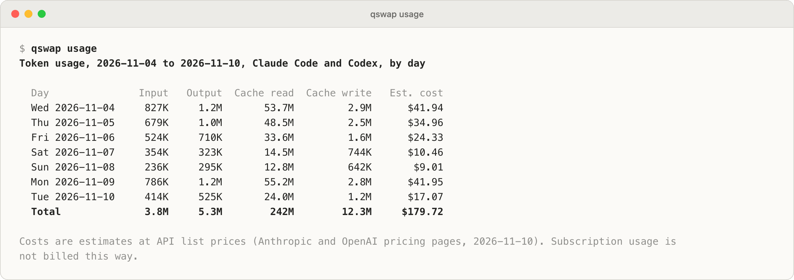
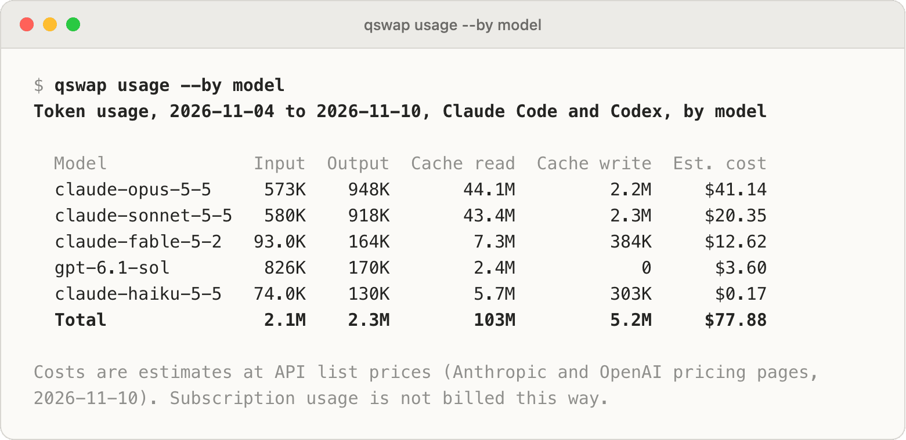

# Tokens and cost: `qswap usage`

`qswap usage` reports how many tokens you used, on which account, model and project, and what they would have cost at API list prices. After this page you can read the report, pick its dates and grouping, correct a price, and see what Anthropic billed an organization.

<picture>
  <source media="(prefers-color-scheme: dark)" srcset="../assets/screenshots/raw/usage.png">
  
</picture>

## Group the report

With no flags you get the last 7 days, one row per day, Claude Code and Codex together. `--by` picks the rows:

```text
$ qswap usage --by account
Token usage, 2026-11-04 to 2026-11-10, Claude Code and Codex, by account

  Account                    Input  Output  Cache read  Cache write  Est. cost
  Claude #1 personal          635K    1.0M       47.9M         2.4M     $33.41
  Claude #2 work              388K    653K       29.5M         1.6M     $22.70
  Claude #5 ci                278K    442K       20.9M         1.1M     $16.35
  Codex #2 work               582K    123K        1.7M            0      $2.57
  Claude #3 night-shift      19.5K   49.6K        2.2M         105K      $1.82
  Codex #1 maya@example.com   244K   47.4K        694K            0      $1.03
  Total                       2.1M    2.3M        103M         5.2M     $77.88

Costs are estimates at API list prices (Anthropic and OpenAI pricing pages,
2026-11-10). Subscription usage is not billed this way.
```

Accounts are named as everywhere else in qswap: `#2 work`, or `#1 maya@example.com` when the account has no alias. Claude Code and Codex number their accounts separately, so a report holding both providers' usage starts each account with its provider. A login qswap does not manage shows as its email followed by `(not managed)`.

The other groupings are `model`, `project`, `provider` and `session`. The session view lists the 50 most expensive sessions and then a line such as `… 55 more (--json lists all)`. `--provider claude` or `--provider codex` limits the report to one CLI.

<picture>
  <source media="(prefers-color-scheme: dark)" srcset="../assets/screenshots/raw/usage-by-model.png">
  
</picture>

Every line fits 80 columns. A label too long for its column is cut with `…`: account and model names lose their end, project paths their start (`…/checkout-api`). `--json` always has the whole label; its fields are in [json-output.md](json-output.md).

## Pick the dates

```bash
qswap usage --days 30                              # the last 30 days, today included
qswap usage --since 2026-11-01 --until 2026-11-07  # local days, both included
```

`--since` without `--until` runs to today. When there is nothing to show, the report says why instead of printing a table of zeros:

```text
$ qswap usage
No Claude Code or Codex session files were found in ~/.claude/projects,
~/.codex/sessions or ~/.codex/archived_sessions.
Use Claude Code or Codex, then run qswap usage again.
```

## What the numbers mean

| Column | Meaning |
|---|---|
| Input | Input tokens not served from the prompt cache |
| Output | Output tokens, thinking and reasoning tokens included |
| Cache read | Input tokens served from the prompt cache |
| Cache write | Input tokens written to the prompt cache. Claude's 5-minute and 1-hour writes are added together here; `--json` keeps them apart |
| Est. cost | What the row would have cost at the vendor's API list price |

Each response is counted once. Claude Code writes a response several times as it streams and copies earlier responses into a resumed session's file; qswap keeps one copy. Sub-agent requests are separate requests and are counted.

## The cost is an estimate

The dollar figure is what the same tokens would cost on the pay-as-you-go API. A Claude or ChatGPT subscription is not billed per token, so read it as a measure of what you used, not as a bill.

- Prices come from a table inside qswap, copied from the Anthropic and OpenAI pricing pages on 2026-11-10. The report's footer prints that date, and `--json` has it as `pricing.fetched`.
- Long-context and prompt-length tiers use the base price. Claude Haiku 5.5 prompts over 100,000 tokens and OpenAI requests over 272K input tokens cost more on the API than shown.
- Batch, Flex and data-residency pricing are not applied, and neither is OpenAI's Fast (priority) processing, because Codex does not record which tier a request used.
- Claude fast mode is priced at Anthropic's fast-mode rates. Those exist for Fable 5.2, Mythos 5.2, Opus 5.5, Opus 5 and Opus 4.8; a fast request on another model has no price.
- A model the table does not know shows `n/a` for cost and is named under the table (`No price for: ...`). A cost ending in `+` leaves those tokens out.

### Your own prices

Put a `pricing.json` next to `ledger.db` in the data directory (`~/.ai-quota-swap/` on macOS and Windows, `~/.local/share/ai-quota-swap/` on Linux) to add a model or correct a price, in US dollars per million tokens:

```json
{
  "models": {
    "claude-opus-5-5": {"input": 4, "output": 20, "cache_read": 0.2, "cache_write_5m": 5, "cache_write_1h": 8},
    "my-proxy-*": {"input": 2, "output": 10},
    "some-model": null
  }
}
```

`input` and `output` are required. A missing cache price defaults to the input price (a missing `cache_write_1h` to `cache_write_5m` when that is given). An entry matches its exact model id and dated snapshots of it (`claude-opus-4` also prices `claude-opus-4-20250514`). End an entry in `*` to match every id that starts with it. `null` marks a model as unpriced. The file is read on every run, so a corrected price applies to old usage too. A file qswap cannot use is named in a `Pricing override:` line under the report.

## What Anthropic billed

`--billed` adds a section for each organization whose Admin API key you registered with `qswap api org add` (see [api-accounts.md](api-accounts.md#register-an-organizations-admin-key)): tokens from Anthropic's usage report and dollars from its cost report, for the same dates. It is the only part of `qswap usage` that uses the network. With no organization registered, the section says so:

```text
$ qswap usage --billed
...
Billed by Anthropic, 2026-11-04 to 2026-11-10 (UTC days), by day
No organization registered: add one with qswap api org add,
or set ANTHROPIC_ADMIN_KEY for one command.
```

- Days are UTC, as in Anthropic's reports; the rest of `qswap usage` uses local days.
- The section can be grouped by `day`, `model`, `key` or `workspace`. `--by account` reads as `key`. `--by key` and `--by workspace` need `--billed`. With `project`, `provider` or `session` the section is by day and says why.
- With `--by key`, each key is labelled with its name and the account it is linked to, such as `ci-runner (#5)`. Anthropic's cost report cannot be split by key, so each key's cost is its tokens at list prices, headed `Est. cost`; the total is the cost report's.
- The cost report is the bill's view, so it will not match the estimate above it. It leaves out Priority Tier, which Anthropic bills separately. With `--by model`, charges that have no model are rows of their own, named by their cost type in parentheses.
- Anthropic's reports lag by about five minutes, and qswap keeps each answer for five minutes.
- A failure is one line in the section: the Admin key was rejected (with the commands that replace it), it may not read usage reports, the Admin API is rate limiting, or no usage has been reported for the window yet.

## How usage is attributed to accounts

Session files do not record which account served them, so qswap keeps its own record. `activations.jsonl` in the data directory gets a line each time qswap switches accounts, and each time it notices that Claude Code's login changed some other way (a `/login`, another tool). It notices whenever it reads your accounts (`qswap list`, the dashboard, the menu bar, auto-switch) and when `qswap usage` runs. Each response belongs to the account that was active at its timestamp.

- Usage from before the first line is unattributed. qswap does not guess at older history.
- A login change made outside qswap counts from the moment qswap notices it.
- `qswap run` sessions: a profile with its own history (`--no-share-history`) owns its files. With shared history, the default, Claude Code stamps each session with the account that started it. When that account differs from the one the record says was active at the session's start, and the stamp comes before the session's first response, the whole session goes to the stamped account, since a profile's login never changes. Other sessions follow the record, through a switch in the middle too. That includes a session started while an API key was active: Claude Code stamps it only after the key is left, with the login's account (read in the Claude Code 2.1.322 binary), and its usage on the key stays with the key. Sessions from Claude Code versions without the stamp follow the record.
- The Claude desktop app runs Claude Code on its own login, which qswap does not switch. Its sessions are listed as `Claude desktop app`, apart from every account.
- Codex keeps its own record, `codex/activations.jsonl`: a line for each `qswap codex switch` and each switch `qswap codex auto` makes, and one whenever qswap notices that Codex's login changed. Codex usage from before its first line is unattributed.

`--by account` prints the unattributed share under the table (`Unattributed: 12% of tokens, ...`), and so does any other view when it is at least 0.5%. `--json` has it as `unattributedShare`.

## What it reads

- Claude Code: the `projects/` folder of `~/.claude` (or `$CLAUDE_CONFIG_DIR`), sub-agent transcripts included, and the history of each `qswap run` profile that keeps its own.
- Codex: `sessions/` and `archived_sessions/` under `~/.codex` (or `$CODEX_HOME`), compressed `.jsonl.zst` files included.

Nothing is sent anywhere. qswap keeps token counts, model names, project folders, session ids and timestamps in `ledger.db` in the data directory, and no message content.

A run reads only the files its dates need, newest first, and later runs read only what was added since. A file last changed more than a day before the first day cannot hold usage from those days, so it waits until a wider `--days`, an earlier `--since` or `--all` asks for it. The report then ends with a line saying how many older files are not in the ledger yet (`scan.olderFilesNotInLedger` in `--json`). Progress shows on a terminal. Ctrl-C keeps what was read so far, and the next run continues from there.

## Flags

| Flag | Effect |
|---|---|
| `--days N` | The last N days, today included (default 7) |
| `--since DATE` | First day, `YYYY-MM-DD`, local time |
| `--until DATE` | Last day, included; needs `--since` (default today) |
| `--by GROUP` | Rows by `day` (default), `model`, `account`, `project`, `provider` or `session`; `key` and `workspace` with `--billed` |
| `--provider claude\|codex` | Only one CLI's usage |
| `--json` | The same report as JSON |
| `--billed` | Add each registered organization's billed usage (Admin API) |
| `--no-scan` | Report from what was read before, without reading new files |
| `--rescan` | Read every session file again from scratch (slow) |
| `--all` | Read every session file, not only those the dates need |
| `--debug` | Log debug detail |

`--days` and `--since` exclude each other, and so do `--no-scan`, `--rescan` and `--all`.

## Settings

| Setting | Default | Meaning |
|---|---|---|
| `run.shareHistory` | `true` | `qswap run` sessions write to the shared history in `~/.claude`; `false` gives each profile its own, which `qswap usage` attributes to that profile's account |

Change it with `qswap config set run.shareHistory false`. The full list is in [settings.md](settings.md).

## Limits

- Attribution starts the first time qswap reads your accounts, and a login change made outside qswap counts from when qswap notices it.
- Compressed Codex files need Python 3.14 or newer, or the `zstandard` package. Without either they are skipped, and a line under the report says how many.
- Session files that cannot be read (for example, links to a volume that is not mounted) are counted under the report and read once they are back.
